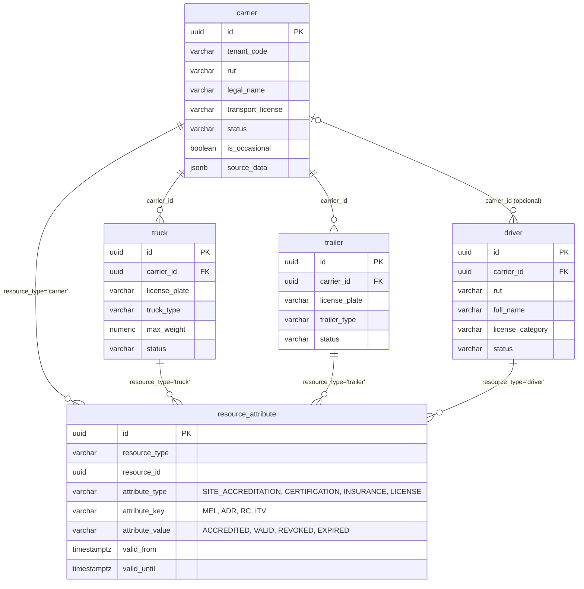
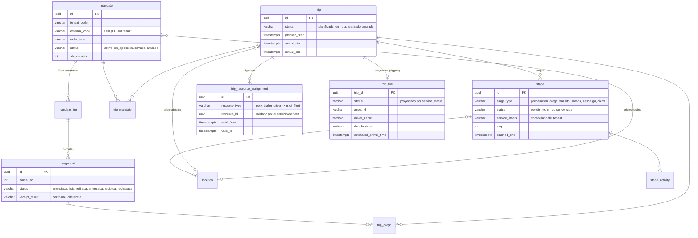

# El modelo a implementar

## Principios

1. **Encargo ≠ ejecución.** El `mandate` es lo que el cliente pide (código externo, origen/destino,
   SLA). El `trip` es cómo se ejecuta. N mandatos pueden viajar en un viaje (`trip_mandate`) y un
   mandato puede necesitar varios viajes.
2. **Las etapas SON los estados.** El avance de un viaje no es un campo `status` que se PATCHea:
   es abrir y cerrar etapas (`stage`) de un catálogo cerrado (`preparacion`, `carga`, `transito`,
   `parada`, `descarga`, `cierre`). Una sola etapa en curso a la vez (índice parcial). Abrir la
   primera pone el viaje `en_ruta`; cerrar la etapa `cierre` lo realiza.
3. **`service_status`: la etapa proyecta el estado de negocio.** Cada etapa puede declarar qué
   estado —en el vocabulario del tenant— proyecta al tablero mientras corre (un tenant:
   `ADDED`/`SCHEDULED`/`ONGOING`/`ARRIVED`/`FINISHED`; otro: `en ruta`/`cerrado`). Es dato, no
   comportamiento: el motor no conoce vocabularios.
4. **`trip_live` es proyección, no registro.** La fila caliente del tablero la mantienen triggers
   del registro (nace con el viaje, muere al realizarlo/anularlo). No tiene API de escritura.
5. **Recursos en su propio módulo.** Flota (transportista, camión, remolque, conductor) y
   acreditación viven en `miot_fleet`, con ciclo de vida propio e independiente de los viajes.
   `miot_trips` los referencia por id; `AssignmentService` valida la referencia con el servicio de fleet.
6. **Versionado SCD2 en la misma tabla.** Nada se pisa: cada UPDATE archiva la versión anterior
   (trigger genérico). La fila vigente conserva su `id` (las FKs no se tocan) y es la única con
   `version_of IS NULL AND is_active`. El borrado es lógico (`is_active = false`). La explotación
   histórica se hace sobre la misma tabla con las ventanas `version_from`/`version_to`.
7. **Multi-tenant por `tenant_code`** en cada tabla y cada WHERE, con FKs compuestas
   `(id, tenant_code)` — mismo patrón que miot-symptoms.
8. **Auditoría en todo**: `audit_event` registra actor y acción de cada operación de dominio.

## DER — miot_fleet (PR 2)

`resource_attribute` es el heredero directo de `ams.rd_resource_attributes`: acreditaciones de
faena, certificaciones, seguros y licencias como atributos con vigencia, upsert por clave natural
`(tenant, resource_type, resource_id, attribute_type, attribute_key)` sobre la versión vigente.

## DER — miot_trips (PR 3)

## Versionado SCD2 — cómo funciona

Columnas en cada tabla de registro: `version_of UUID` (NULL = vigente), `is_active BOOLEAN`,
`version_from`, `version_to`. Trigger genérico `fn_version_on_update()` (schema-agnóstico,
`TG_TABLE_SCHEMA`): en cada UPDATE inserta la imagen anterior como fila archivada
(`version_of = id vigente`, ventana cerrada) y la vigente sigue con su `id`.

- Los índices de unicidad de negocio son **parciales**: `WHERE version_of IS NULL AND is_active`.
- Distinción deliberada: `version_from/to` (ventana de la **versión**) ≠
  `valid_from/to` de `trip_resource_assignment` (vigencia **operativa** de la asignación).
- Consulta histórica: misma tabla, `WHERE version_of = :id OR id = :id ORDER BY version_from`.

## Triggers de integridad (además del versionado)

| Trigger | Regla |
|---|---|
| una etapa en curso | índice parcial único sobre `(subject_type, subject_id) WHERE status='en_curso' AND version_of IS NULL AND is_active` |
| proyección `trip_live` | nace con el viaje, refresca con etapas/asignaciones (`COALESCE(service_status, status)`), muere al realizar/anular |

## Reglas en los services

| Dónde | Regla |
|---|---|
| `AssignmentService` | el recurso asignado existe en `miot_fleet` para el tenant y no está `inactive` (400) |
| `MandateStore.insertOrGet` | crear mandato ⇒ crea su `mandate_line` seq 1 |
| `TripCargoService.mount` | montar una carga vincula al viaje el mandato dueño de la carga |
| `MandateService.requireOpen` | un mandato cerrado o anulado no toma viajes nuevos, directo ni por carga montada (409) |
