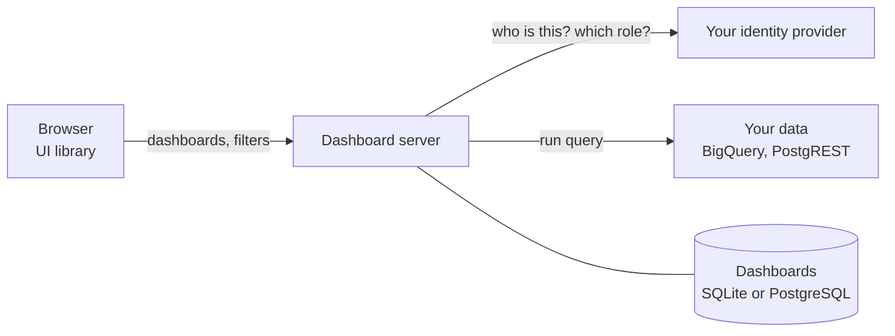

import { Callout, Cards } from 'nextra/components'

# Dashboards

**For:** everyone. If you are deciding whether to use the product, read this whole page.

ModularIoT Dashboards is for building operational dashboards, sharing them and embedding them in another application. A dashboard is a grid of widgets: numbers, bars, pies, tables and text. Each widget reads the result of a query to your data.

## What it does

| Capability | What it means |
| --- | --- |
| Grid editor | Drag and resize widgets on a 24-column grid. Changes save on their own. |
| Widgets | Text, indicators (KPIs), stacked bars, bar, line, pie and gauge charts, tables and lists. |
| Queries | Each widget reads a saved query. SQL queries are written and tested in an editor (BigQuery) or exposed as functions (PostgREST). |
| Filters | Text, date range and selection. A filter changes the parameters of the queries that use it. |
| Permissions | Four roles per scope, plus extra roles per dashboard for people or groups. |
| Organizations | Each organization's dashboards and data are kept separate. |
| Embedding | Show dashboards in your application with React, a Web Component or any HTML page, including Phoenix LiveView. |
| Import and export | Copy a dashboard between environments as a JSON file. |

The browser never receives credentials, data URLs or SQL. The dashboard names a query; the server runs it.

## Typical uses

| Use | Widgets |
| --- | --- |
| Status of an operation: how many records are in each state | Stacked Stat (KPI per state + 100% bar), Data Table |
| Daily or monthly trend | Chart v2 (lines or bars by date) |
| Ranking: the top 10 by number of events | Chart v2 (horizontal bar) |
| Progress toward a goal | Progress Stat, Progress |
| Row-by-row review | Data Table with column filters and CSV export |

## What it does not do yet

| Limit | Alternative |
| --- | --- |
| Clicking a chart does not filter other widgets. | Add a select filter to the dashboard and bind it to the parameter of the table's query. |
| Single-value widgets (Stat, Stacked Stat) read only the first row of the query. | Write the query so it returns one row, with one column per value. |
| A pie chart does not give each category a fixed color. It takes the palette colors in row order. | Sort the rows in the query and set the custom colors in that order. |
| The SQL editor works only with BigQuery. | With PostgreSQL, write the query as a function and publish it with PostgREST. |
| The widget settings panels are React components. | A host that does not use React builds its own settings forms. |
| Maps, containers and file upload exist only in the ModularIoT app. | — |

## Choose your path

| You are | You want | Start at |
| --- | --- | --- |
| Product owner or customer | Know what it does and what it does not | This page and [Choose your path](/en/products/dashboards/getting-started/choose-a-setup) |
| Implementer | Build dashboards in the UI: data, queries, widgets, filters, permissions | [Build your first dashboard](/en/products/dashboards/tutorials/first-dashboard) |
| Developer | Embed dashboards in your application and run the server | [Quickstart](/en/products/dashboards/getting-started/quickstart), then [Embed a dashboard in a web page](/en/products/dashboards/tutorials/embed-in-a-web-page) |

<Cards>
  <Cards.Card title="Choose your path" href="/en/products/dashboards/getting-started/choose-a-setup" arrow />
  <Cards.Card title="Build your first dashboard" href="/en/products/dashboards/tutorials/first-dashboard" arrow />
  <Cards.Card title="Embed a dashboard in a web page" href="/en/products/dashboards/tutorials/embed-in-a-web-page" arrow />
  <Cards.Card title="Widget catalog" href="/en/products/dashboards/reference/widgets" arrow />
</Cards>

## How the parts fit

The browser asks the server for a dashboard and for the results of its queries. The server checks who is asking and what their role allows. Then it runs the query with credentials the browser does not see. Details in [Architecture](/en/products/dashboards/concepts/architecture).

## The three packages

Three open-source npm packages, Apache 2.0 license.

| Package | Version | Role |
| --- | --- | --- |
| [`@microboxlabs/miot-dashboard-server`](/en/products/dashboards/reference/server-library) | 0.8.0 | Stores dashboards, checks every request and runs the queries. |
| [`@microboxlabs/miot-dashboard-ui`](/en/products/dashboards/reference/ui-library) | 0.1.2 | Draws and edits dashboards in the browser. |
| [`@microboxlabs/miot-dashboard-contract`](/en/products/dashboards/reference/contract) | 0.6.0 | Document format, roles, errors and the OpenAPI definition. |

The server also ships as a container image and a Helm chart. See [Installation](/en/products/dashboards/getting-started/installation).

## How this guide is organized

| Section | Content |
| --- | --- |
| Getting started | Choose a path, run the server for the first time |
| Learn | Short pages, in order, with examples: first dashboard, queries, embedding |
| How-to guides | One task: add a filter, connect BigQuery |
| Concepts | How the parts work |
| Deployment | Production and upgrades |
| Reference | Every widget, setting, API route and limit |

<Callout type="info">
Pages that show the ModularIoT UI say so in their first line ("ModularIoT setup"). Everything else applies to any application that uses the libraries.
</Callout>
