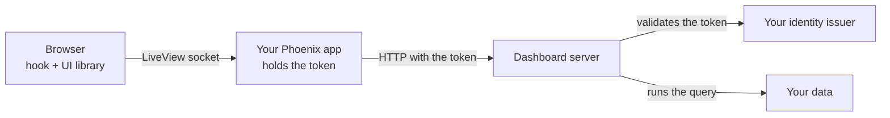

import { Callout, Steps } from 'nextra/components'

# Embed in Phoenix LiveView

**For:** developers. **Setup:** your own Phoenix LiveView application, with the dashboard server running separately.

<Callout type="info">
**You will learn to:**

- call the dashboard server from Elixir with the person's token or ticket;
- load the UI library without React in your code;
- draw the dashboard from a LiveView hook;
- run saved queries without the browser seeing the token;
- save layout changes, apply filters and turn on edit mode.
</Callout>

## How the parts fit



| Part | Does |
| --- | --- |
| Your Phoenix app | Signs people in, keeps the token in the encrypted session and calls the dashboard server |
| The LiveView | Holds the dashboard document, answers the hook's events and saves |
| The JavaScript hook | Draws the dashboard with `mountDashboard` and sends queries and layout changes to the LiveView |
| The dashboard server | Validates the token, decides permissions and runs the queries |

The browser never receives the token. Queries travel over the LiveView socket.

## Before you start

| You need | See |
| --- | --- |
| The dashboard server with JWT or ticket authentication | [Authenticate users](/en/products/dashboards/how-to/authenticate-users) |
| An organization and a scope with at least one dashboard | [Quickstart](/en/products/dashboards/getting-started/quickstart) |
| Phoenix 1.7 or later with LiveView and `Req` | — |

<Steps>

### Call the server from Elixir

A module sends every request with the person's token. Paths carry the organization (`tenant`) and the scope.

```elixir filename="lib/my_app/dashboards.ex"
defmodule MyApp.Dashboards do
  @header "authorization" # or the header in MIOT_DASHBOARD_TICKET_HEADER

  defp request(token, method, path, opts \\ []) do
    {headers, opts} = Keyword.pop(opts, :headers, [])
    Req.request([
      method: method,
      url: Application.fetch_env!(:my_app, :dashboard_url) <> path,
      headers: [{@header, token} | headers],
      retry: false
    ] ++ opts)
  end

  defp path(tenant, scope, slug),
    do: "/tenants/#{URI.encode_www_form(tenant)}/scopes/#{URI.encode_www_form(scope)}/dashboards/#{URI.encode_www_form(slug)}"

  def load(token, tenant, scope, slug) do
    case request(token, :get, path(tenant, scope, slug)) do
      {:ok, %{status: 200, body: %{"data" => doc}} = r} ->
        {:ok, doc, List.first(Req.Response.get_header(r, "etag"))}
      {:ok, %{status: status}} -> {:error, status}
      {:error, _} -> {:error, 503}
    end
  end

  def save(token, tenant, scope, slug, doc, etag) do
    case request(token, :put, path(tenant, scope, slug), json: doc, headers: [{"if-match", etag}]) do
      {:ok, %{status: 200} = r} -> {:ok, List.first(Req.Response.get_header(r, "etag"))}
      {:ok, %{status: status}} -> {:error, status}
      {:error, _} -> {:error, 503}
    end
  end

  def run_query(token, tenant, scope, slug, query_id, filters) do
    case request(token, :post, path(tenant, scope, slug) <> "/queries/#{URI.encode_www_form(query_id)}",
           json: %{filters: filters}) do
      {:ok, %{status: 200, body: %{"data" => %{"rows" => rows}}}} -> {:ok, rows}
      {:ok, %{status: status}} -> {:error, status}
      {:error, _} -> {:error, 503}
    end
  end
end
```

With JWT, the header value is `Bearer <token>`. With a ticket, use the header and format configured on the server (`MIOT_DASHBOARD_TICKET_HEADER`, `MIOT_DASHBOARD_TICKET_SCHEME`).

Every save sends the revision (`If-Match`). If someone else saved first, the server answers `409`: reload the document. To create a dashboard, save with `If-Match: "0"`.

### Keep the token in the session

The token stays in the server session and is checked on every LiveView mount.

```elixir filename="lib/my_app_web/endpoint.ex"
@session_options [
  store: :cookie,
  key: "_my_app_key",
  signing_salt: "…",
  encryption_salt: "…",
  same_site: "Lax"
]
```

```elixir filename="lib/my_app_web/live/auth.ex"
defmodule MyAppWeb.Live.Auth do
  import Phoenix.Component
  import Phoenix.LiveView

  def on_mount(:require_token, _params, %{"token" => token}, socket) when is_binary(token),
    do: {:cont, assign(socket, token: token)}

  def on_mount(:require_token, _params, _session, socket),
    do: {:halt, redirect(socket, to: "/login")}
end
```

With `encryption_salt`, the cookie is encrypted as well as signed. Add the token parameter name to `filter_parameters` so it does not reach the logs.

### Serve the UI library

Copy three files to `priv/static/vendor/`. Pin the versions.

| File | Source |
| --- | --- |
| `dashboard-runtime.js` | `@microboxlabs/miot-dashboard-ui/dist/browser/browser-charts.js` |
| `dashboard.css` | `@microboxlabs/miot-dashboard-ui/styles.css` |
| `echarts.js` | The ESM build of ECharts 6 (`echarts/dist/echarts.esm.min.js`) |

```bash
npm pack @microboxlabs/miot-dashboard-ui@0.1.2
tar -xzf microboxlabs-miot-dashboard-ui-0.1.2.tgz
cp package/dist/browser/browser-charts.js priv/static/vendor/dashboard-runtime.js
cp package/styles.css priv/static/vendor/dashboard.css
```

`browser-charts.js` bundles React and needs no build step. If you do not use charts, use `browser.js`: it is smaller and needs no ECharts.

Load the CSS in the layout:

```heex filename="lib/my_app_web/components/layouts/root.html.heex"
<link rel="stylesheet" href={~p"/vendor/dashboard.css"} />
```

### Write the hook

The hook builds the widget registry, mounts the dashboard and connects events with the LiveView.

```js filename="assets/js/dashboard_canvas.js"
// Paths in variables so esbuild does not try to bundle the files.
const runtimeUrl = "/vendor/dashboard-runtime.js"
const echartsUrl = "/vendor/echarts.js"
const runtime = () => import(runtimeUrl)
const echarts = () => import(echartsUrl)

const labels = {
  loadingLabel: "Loading…",
  errorLabel: "Could not load the data.",
  unsupportedDataLabel: "This widget needs a saved query.",
}

let registryPromise
function registry() {
  registryPromise ??= Promise.all([runtime(), echarts()]).then(([ui, ec]) => {
    const definitions = [
      ...ui.createStackedStatRegistry({ ...labels, defaultTitle: "Breakdown", defaultUnit: "", emptyLabel: "No items" }).all(),
      ...ui.createIconStatRegistry({ ...labels, defaultTitle: "Total" }).all(),
      ...ui.createChartRegistry({
        ...labels,
        defaultTitle: "Chart",
        emptyLabel: "No data",
        rangeLabels: { all: "All", "7d": "7D", "30d": "30D", "90d": "3M", "180d": "6M", "1y": "1Y" },
        createEngine: (element) => {
          const chart = ec.init(element)
          return {
            update: (option) => chart.setOption(option, { notMerge: true }),
            resize: () => chart.resize(),
            dispose: () => chart.dispose(),
          }
        },
      }).all(),
      // Add the other registries you use here: tables, text, etc.
    ]
    return { ui, registry: { get: (id) => definitions.find((d) => d.meta.id === id) } }
  })
  return registryPromise
}

export const DashboardCanvas = {
  async mounted() {
    const { ui, registry: widgets } = await registry()
    const client = {
      key: () => this.el.dataset.key,
      query: (_slug, queryId, filters) =>
        new Promise((resolve, reject) =>
          this.pushEvent("run_query", { queryId, filters }, (reply) =>
            reply.error ? reject(new Error(reply.error)) : resolve(reply.rows))),
    }
    const options = (canvas) => ({
      instanceKey: this.el.dataset.key,
      registry: widgets,
      widgets: canvas.widgets,
      unknownWidgetLabel: "This widget is not available.",
      editMode: canvas.edit,
      onLayoutCommit: (layout) => this.pushEvent("layout_commit", { layout }),
      savedQueries: {
        client,
        slug: this.el.dataset.key,
        queries: canvas.queries,
        filters: canvas.filters,
        refreshIntervalMs: 0,
        paused: false,
        errorMessage: labels.errorLabel,
      },
    })
    const target = document.createElement("div")
    this.el.replaceChildren(target)
    this.mount = ui.mountDashboard(target, options(JSON.parse(this.el.dataset.canvas)))
    this.handleEvent("dashboard:render", (canvas) => this.mount.update(options(canvas)))
  },
  destroyed() {
    this.mount?.destroy()
  },
}
```

```js filename="assets/js/app.js"
import { DashboardCanvas } from "./dashboard_canvas"
const liveSocket = new LiveSocket("/live", Socket, { hooks: { DashboardCanvas }, params: { _csrf_token: csrfToken } })
```

| Part | Does |
| --- | --- |
| `this.el.replaceChildren(target)` | `mountDashboard` needs an empty element. Otherwise it throws `occupied-container` |
| Stable `instanceKey` | Changing it drops widget state. New filters arrive through `update` |
| `query` with `pushEvent` and a reply | The LiveView runs the query with the token. The browser only receives rows |
| `destroy()` in `destroyed()` | Releases React and the charts when you leave the page |

### Write the LiveView

The LiveView loads the document, gives the state to the hook and answers its events.

```elixir filename="lib/my_app_web/live/dashboard_live.ex"
defmodule MyAppWeb.DashboardLive do
  use MyAppWeb, :live_view
  on_mount {MyAppWeb.Live.Auth, :require_token}
  alias MyApp.Dashboards

  def mount(%{"tenant" => tenant, "scope" => scope, "slug" => slug}, _session, socket) do
    {:ok, doc, etag} = Dashboards.load(socket.assigns.token, tenant, scope, slug)
    {:ok, assign(socket, tenant: tenant, scope: scope, slug: slug, doc: doc, etag: etag, filters: %{}, edit: false)}
  end

  defp canvas(a), do: %{widgets: a.doc["widgets"] || [], queries: a.doc["queries"] || [], filters: a.filters, edit: a.edit}
  defp redraw(socket), do: push_event(socket, "dashboard:render", canvas(socket.assigns))

  def render(assigns) do
    ~H"""
    <button phx-click="toggle_edit">{if @edit, do: "Done", else: "Edit"}</button>
    <div
      id={"canvas-#{@tenant}-#{@scope}-#{@slug}"}
      phx-hook="DashboardCanvas"
      phx-update="ignore"
      data-key={"#{@tenant}/#{@scope}/#{@slug}"}
      data-canvas={Jason.encode!(canvas(assigns))}
    />
    """
  end

  def handle_event("run_query", %{"queryId" => id, "filters" => filters}, socket) do
    a = socket.assigns
    case Dashboards.run_query(a.token, a.tenant, a.scope, a.slug, id, filters) do
      {:ok, rows} -> {:reply, %{rows: rows}, socket}
      {:error, _} -> {:reply, %{error: "Could not load the data."}, socket}
    end
  end

  def handle_event("layout_commit", %{"layout" => items}, socket) do
    positions = Map.new(items, &{&1["i"], Map.take(&1, ~w(x y w h))})
    widgets =
      for w <- socket.assigns.doc["widgets"] || [] do
        case positions[w["id"]] do
          nil -> w
          p -> %{w | "layout" => Map.merge(w["layout"], p)}
        end
      end
    {:noreply, save(socket, Map.put(socket.assigns.doc, "widgets", widgets))}
  end

  def handle_event("toggle_edit", _, socket),
    do: {:noreply, socket |> update(:edit, &(!&1)) |> redraw()}

  defp save(socket, doc) do
    a = socket.assigns
    case Dashboards.save(a.token, a.tenant, a.scope, a.slug, doc, a.etag) do
      {:ok, etag} -> assign(socket, doc: doc, etag: etag)
      {:error, 409} -> put_flash(socket, :error, "Someone else saved this dashboard. Reload.")
      {:error, _} -> put_flash(socket, :error, "Could not save.")
    end
  end
end
```

`phx-update="ignore"` stops LiveView from replacing the `div`'s content. The dashboard updates only through the `dashboard:render` event.

### Apply filters

Keep filter values in the LiveView and send them with `redraw/1`. Queries that bind those filters run again.

```elixir
def handle_event("apply_filters", %{"filters" => values}, socket) do
  filters = values |> Enum.reject(fn {_k, v} -> v == "" end) |> Map.new()
  {:noreply, socket |> assign(filters: filters) |> redraw()}
end
```

Filters are defined in the document (`filters`). The filter bar form is yours: the library has none without React. A date range provides `<key>_from` and `<key>_to`. See [Add filters](/en/products/dashboards/how-to/add-filters).

</Steps>

## Edit mode and widget settings

In edit mode (`editMode: true`), the grid lets people move and resize widgets and calls `onLayoutCommit`. You build the rest:

| You need | The library without React | You build |
| --- | --- | --- |
| Buttons per widget (settings, duplicate, delete) | Not drawn. `Frame` only takes a React component | Your own buttons on each `.miot-widget`, and an event to the LiveView. The `id` of each `.miot-widget` ends in `-widget-<widget id>` |
| A settings form per widget | No | Forms in LiveView. Each widget's keys are in the [widget reference](/en/products/dashboards/reference/widgets) |
| Saved-query editor | No | A form that adds `{id, variableName, connectionId, operationId, parameters}` to `queries`. The catalog is at `GET …/dashboards/{slug}/query-catalog` |
| Permissions | No | A form on `…/dashboards/{slug}/permissions` |
| Autosave with undo | No | Save on every change, or batch changes and save on a timer |

## Theme and language

| What | How |
| --- | --- |
| Card colors | CSS variables: `--miot-card-background`, `--miot-card-border`, `--miot-card-text`, `--miot-card-muted`, `--miot-accent`, `--miot-focus-color`, `--miot-progress-color` |
| Chart dark mode | `darkMode` in `createChartRegistry`. It is read when the registry is created: to change it, create the registry again and remount |
| Text | Each registry takes its labels (`loadingLabel`, `defaultTitle`, …). The library ships no translations |

<Callout type="warning">
**Pitfall:** if your CSS does not use Tailwind, add `.miot-widget { position: relative; }`. Without it, buttons you position over a widget end up in the wrong place.
</Callout>

## LiveView and the ModularIoT setup

| Capability | ModularIoT setup | Phoenix LiveView |
| --- | --- | --- |
| Sign-in and token | The web app | Your Phoenix app |
| Drawing the dashboard and grid | Library (React) | Library (`mountDashboard`) |
| Charts | Library and ECharts | Library and the ECharts you serve |
| Settings form per widget | Built by the app | Built by you |
| Saved queries | Library editor (React) | Your own form |
| BigQuery SQL editor | Library editor (React) | Your own, or use the server's query API |
| Filter bar | Built by the app | Built by you |
| Permissions | Library editor (React) | Your own form |
| Autosave and undo | Yes | You decide when to save |
| Import and export | Yes | The document is JSON: download it with `load/4` |
| Maps, containers, file upload | Yes | Not in the library |
| Dark mode | Yes | Charts only, with `darkMode` |

The lack of forms without React is tracked in [#2239](https://github.com/microboxlabs/modulariot/issues/2239).

## Common errors

| Symptom | Cause | Fix |
| --- | --- | --- |
| `Dashboard mount: occupied-container` | The element was not empty | `this.el.replaceChildren(target)` before mounting |
| The dashboard disappears after an event | LiveView replaced the `div` | `phx-update="ignore"` on the hook's `div` |
| Widgets show "Could not load the data." | `run_query` replied with `error` | Check the LiveView log and the server's HTTP status |
| A widget says "This widget is not available." | Your registry lacks that `componentId` | Add its registry function |
| Save answers `409` | Someone else saved first | Reload the document and its revision |
| Charts do not appear | You used `browser.js` or did not serve ECharts | Use `browser-charts.js` and pass `createEngine` |

## Related

- [Embed a dashboard in a web page](/en/products/dashboards/tutorials/embed-in-a-web-page)
- [REST API](/en/products/dashboards/reference/rest-api)
- [UI library](/en/products/dashboards/reference/ui-library)
