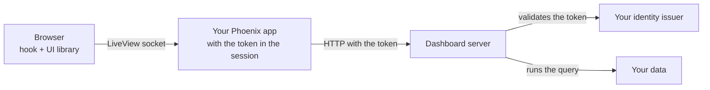

import { Callout, Steps } from 'nextra/components'

# Embed in Phoenix LiveView

**For:** developers. **Setup:** your own Phoenix LiveView application, with the dashboard server running separately.

<Callout type="info">
**You will learn to:** call the dashboard server from Elixir, load the UI library without React, draw the dashboard from a hook and run saved queries without the page's JavaScript seeing the token.
</Callout>

## Components



| Part | Does |
| --- | --- |
| Your Phoenix app | Signs people in, keeps the token in the encrypted session cookie and calls the dashboard server |
| The LiveView | Holds the dashboard document, answers the hook's events and saves |
| The JavaScript hook | Draws the dashboard with `mountDashboard` and sends queries and layout changes to the LiveView |
| The dashboard server | Validates the token, decides permissions and runs the queries |

The hook sends queries through the LiveView socket. The page's JavaScript never sees the token.

## Before you start

| You need | See |
| --- | --- |
| The dashboard server with JWT or ticket authentication | [Authenticate users](/en/products/dashboards/how-to/authenticate-users) |
| An organization and a scope with at least one dashboard | [Quickstart](/en/products/dashboards/getting-started/quickstart) |
| Phoenix 1.7 or later, LiveView 1.0 or later | — |
| `{:req, "~> 0.5"}` in `mix.exs` | — |

<Steps>

### Configure the server address

```elixir filename="config/runtime.exs"
config :my_app, dashboard_url: System.fetch_env!("DASHBOARD_URL")
```

`DASHBOARD_URL` is the base address of the dashboard server, for example `http://dashboards:3070`.

### Sign in and keep the token

Your login gets the token from the identity issuer and stores it in the session:

```elixir filename="lib/my_app_web/controllers/session_controller.ex"
def create(conn, %{"token" => token}) do
  conn
  |> configure_session(renew: true)
  |> put_session("token", token)
  |> redirect(to: ~p"/dashboards")
end
```

Encrypt the session cookie and keep the token out of the logs:

```elixir filename="lib/my_app_web/endpoint.ex"
@session_options [
  store: :cookie,
  key: "_my_app_key",
  signing_salt: "…",
  encryption_salt: "…",
  same_site: "Lax"
]
```

```elixir filename="config/config.exs"
config :phoenix, :filter_parameters, ["password", "token"]
```

Each LiveView checks that there is a token:

```elixir filename="lib/my_app_web/live/auth.ex"
defmodule MyAppWeb.Live.Auth do
  import Phoenix.Component
  import Phoenix.LiveView

  def on_mount(:require_token, _params, %{"token" => token}, socket) when is_binary(token),
    do: {:cont, assign(socket, token: token)}

  def on_mount(:require_token, _params, _session, socket),
    do: {:halt, redirect(socket, to: "/login")}
end
```

```elixir filename="lib/my_app_web/router.ex"
live_session :dashboards, on_mount: {MyAppWeb.Live.Auth, :require_token} do
  live "/dashboards/:tenant/:scope/:slug", MyAppWeb.DashboardLive
end
```

`tenant` is the organization ID on the dashboard server, not its name. `GET /tenants/{tenant}/scopes/{scope}/dashboards` lists the available `slug`s.

<Callout type="warning">
**Pitfall:** the session cookie cannot exceed 4096 bytes. An encrypted JWT with many groups can get close to that limit. If it does, keep the token on the server (for example in ETS) and only a reference in the session.
</Callout>

### Call the server from Elixir

```elixir filename="lib/my_app/dashboards.ex"
defmodule MyApp.Dashboards do
  # JWT: "authorization" with "Bearer <token>".
  # Ticket: the header in MIOT_DASHBOARD_TICKET_HEADER, with the MIOT_DASHBOARD_TICKET_SCHEME prefix if any.
  defp auth_header(token), do: {"authorization", "Bearer " <> token}

  defp request(token, method, path, opts \\ []) do
    {headers, opts} = Keyword.pop(opts, :headers, [])
    Req.request([
      method: method,
      url: Application.fetch_env!(:my_app, :dashboard_url) <> path,
      headers: [auth_header(token) | headers],
      retry: false
    ] ++ opts)
  end

  defp seg(value), do: URI.encode(value, &URI.char_unreserved?/1)
  defp path(tenant, scope, slug), do: "/tenants/#{seg(tenant)}/scopes/#{seg(scope)}/dashboards/#{seg(slug)}"
  defp etag(response), do: List.first(Req.Response.get_header(response, "etag"))

  def load(token, tenant, scope, slug) do
    case request(token, :get, path(tenant, scope, slug)) do
      {:ok, %{status: 200, body: %{"data" => doc}} = r} when is_map(doc) -> {:ok, doc, etag(r)}
      {:ok, %{status: 200}} -> {:error, 404}
      {:ok, %{status: status}} -> {:error, status}
      {:error, _} -> {:error, 503}
    end
  end

  def save(token, tenant, scope, slug, doc, revision) do
    case request(token, :put, path(tenant, scope, slug), json: doc, headers: [{"if-match", revision}]) do
      {:ok, %{status: 200} = r} -> {:ok, etag(r)}
      {:ok, %{status: status}} -> {:error, status}
      {:error, _} -> {:error, 503}
    end
  end

  def create(token, tenant, scope, slug, name) do
    doc = %{"version" => 2, "name" => name, "preferences" => %{"editMode" => false}, "widgets" => [], "queries" => []}
    save(token, tenant, scope, slug, doc, ~s("0"))
  end

  def run_query(token, tenant, scope, slug, query_id, filters) do
    case request(token, :post, path(tenant, scope, slug) <> "/queries/#{seg(query_id)}", json: %{filters: filters}) do
      {:ok, %{status: 200, body: %{"data" => %{"rows" => rows}}}} -> {:ok, rows}
      {:ok, %{status: status}} -> {:error, status}
      {:error, _} -> {:error, 503}
    end
  end
end
```

| Response | Means |
| --- | --- |
| `401` | The token is invalid or expired. Sign in again |
| `403` | The person has no permission in that organization or scope |
| `404` | The dashboard does not exist. `create/5` creates it with `If-Match: "0"` |
| `409` on save | Someone else saved first. Reload the document and its revision |

### Serve the UI library

Add `vendor` to the static folders. Without it, Phoenix answers 404 to `/vendor/...`:

```elixir filename="lib/my_app_web.ex"
def static_paths, do: ~w(assets fonts images vendor favicon.ico robots.txt)
```

Copy three files to `priv/static/vendor/`. Pin the versions:

```bash
mkdir -p priv/static/vendor /tmp/dashui /tmp/echarts
npm pack @microboxlabs/miot-dashboard-ui@0.1.2 --pack-destination /tmp/dashui
tar -xzf /tmp/dashui/*.tgz -C /tmp/dashui
cp /tmp/dashui/package/dist/browser/browser-charts.js priv/static/vendor/dashboard-runtime.js
cp /tmp/dashui/package/styles.css priv/static/vendor/dashboard.css
npm pack echarts@6.1.0 --pack-destination /tmp/echarts
tar -xzf /tmp/echarts/*.tgz -C /tmp/echarts
cp /tmp/echarts/package/dist/echarts.esm.min.js priv/static/vendor/echarts.js
```

| File | Contains |
| --- | --- |
| `dashboard-runtime.js` | The UI library with React included. No build step |
| `dashboard.css` | Widget styles |
| `echarts.js` | ECharts 6 in ESM format. Only if you use charts |

Without charts, copy `dist/browser/browser.js` instead of `browser-charts.js` and skip ECharts.

Load the CSS in the root layout:

```html filename="lib/my_app_web/components/layouts/root.html.heex"
<link rel="stylesheet" href={~p"/vendor/dashboard.css"} />
```

### Write the hook

```js filename="assets/js/dashboard_canvas.js"
// Paths in variables so esbuild does not try to bundle the files.
const runtimeUrl = "/vendor/dashboard-runtime.js"
const echartsUrl = "/vendor/echarts.js"

const labels = {
  loadingLabel: "Loading…",
  errorLabel: "Could not load the data.",
  unsupportedDataLabel: "This widget needs a saved query.",
}

let registryPromise
function registry() {
  registryPromise ??= Promise.all([import(runtimeUrl), import(echartsUrl)]).then(([ui, ec]) => {
    const definitions = [
      ...ui.createStackedStatRegistry({ ...labels, defaultTitle: "Breakdown", defaultUnit: "", emptyLabel: "No items" }).all(),
      ...ui.createIconStatRegistry({ ...labels, defaultTitle: "Total" }).all(),
      ...ui.createChartRegistry({
        ...labels,
        defaultTitle: "Chart",
        emptyLabel: "No data",
        rangeLabels: { all: "All", "7d": "7D", "30d": "30D", "90d": "3M", "180d": "6M", "1y": "1Y" },
        createEngine: (element) => {
          const chart = ec.init(element)
          return {
            update: (option) => chart.setOption(option, { notMerge: true }),
            resize: () => chart.resize(),
            dispose: () => chart.dispose(),
          }
        },
      }).all(),
      // Add the other registries you use here: tables, text, etc.
    ]
    return { ui, registry: { get: (id) => definitions.find((d) => d.meta.id === id) } }
  })
  return registryPromise
}

export const DashboardCanvas = {
  async mounted() {
    const { ui, registry: widgets } = await registry()
    if (this.gone) return
    const client = {
      key: () => this.el.dataset.key,
      query: (_slug, queryId, filters) =>
        new Promise((resolve, reject) =>
          this.pushEvent("run_query", { queryId, filters }, (reply) =>
            reply.error ? reject(new Error(reply.error)) : resolve(reply.rows))),
    }
    const options = (canvas) => ({
      instanceKey: this.el.dataset.key,
      registry: widgets,
      widgets: canvas.widgets,
      unknownWidgetLabel: "This widget is not available.",
      editMode: canvas.edit,
      onLayoutCommit: (layout) => this.pushEvent("layout_commit", { layout }),
      savedQueries: {
        client,
        slug: this.el.dataset.key,
        queries: canvas.queries,
        filters: canvas.filters,
        refreshIntervalMs: 0,
        paused: false,
        errorMessage: labels.errorLabel,
      },
    })
    const target = document.createElement("div")
    this.el.replaceChildren(target)
    this.mount = ui.mountDashboard(target, options(JSON.parse(this.el.dataset.canvas)))
    this.handleEvent("dashboard:render", (canvas) => this.mount.update(options(canvas)))
  },
  destroyed() {
    this.gone = true
    this.mount?.destroy()
  },
}
```

```js filename="assets/js/app.js"
import { DashboardCanvas } from "./dashboard_canvas"
const liveSocket = new LiveSocket("/live", Socket, { hooks: { DashboardCanvas }, params: { _csrf_token: csrfToken } })
```

The hook uses dynamic `import()`. Build with `--target=es2020` or later in the esbuild configuration (`config/config.exs`). With `es2017`, esbuild cannot leave `import()` unchanged.

| Part | Does |
| --- | --- |
| `this.el.replaceChildren(target)` | `mountDashboard` needs an empty element. Otherwise it throws `occupied-container` |
| Stable `instanceKey` | Changing it drops widget state. New filters arrive through `update` |
| `query` with `pushEvent` and a reply | The LiveView runs the query with the token. The browser only receives rows |
| `destroy()` in `destroyed()` | Releases React and the charts when you leave the page |

### Write the LiveView

```elixir filename="lib/my_app_web/live/dashboard_live.ex"
defmodule MyAppWeb.DashboardLive do
  use MyAppWeb, :live_view
  alias MyApp.Dashboards

  def mount(%{"tenant" => tenant, "scope" => scope, "slug" => slug}, _session, socket) do
    socket = assign(socket, tenant: tenant, scope: scope, slug: slug, doc: nil, etag: nil, filters: %{}, edit: false)
    if connected?(socket), do: {:ok, load(socket)}, else: {:ok, socket}
  end

  defp load(socket) do
    a = socket.assigns
    case Dashboards.load(a.token, a.tenant, a.scope, a.slug) do
      {:ok, doc, etag} -> socket |> assign(doc: doc, etag: etag) |> redraw()
      {:error, 401} -> redirect(socket, to: "/login")
      {:error, _} -> put_flash(socket, :error, "Could not open the dashboard.")
    end
  end

  defp canvas(%{doc: nil}), do: %{widgets: [], queries: [], filters: %{}, edit: false}
  defp canvas(a), do: %{widgets: a.doc["widgets"] || [], queries: a.doc["queries"] || [], filters: a.filters, edit: a.edit}
  defp redraw(socket), do: push_event(socket, "dashboard:render", canvas(socket.assigns))

  def render(assigns) do
    ~H"""
    <button phx-click="toggle_edit">{if @edit, do: "Done", else: "Edit"}</button>
    <div
      id={"canvas-#{@tenant}-#{@scope}-#{@slug}"}
      phx-hook="DashboardCanvas"
      phx-update="ignore"
      data-key={"#{@tenant}/#{@scope}/#{@slug}"}
      data-canvas={Jason.encode!(canvas(assigns))}
    />
    """
  end

  def handle_event("run_query", %{"queryId" => id, "filters" => filters}, socket) do
    a = socket.assigns
    case Dashboards.run_query(a.token, a.tenant, a.scope, a.slug, id, filters) do
      {:ok, rows} -> {:reply, %{rows: rows}, socket}
      {:error, _} -> {:reply, %{error: "Could not load the data."}, socket}
    end
  end

  def handle_event("layout_commit", %{"layout" => items}, socket) do
    positions = Map.new(items, &{&1["i"], Map.take(&1, ~w(x y w h))})
    widgets =
      for w <- socket.assigns.doc["widgets"] || [] do
        case positions[w["id"]] do
          nil -> w
          p -> Map.update(w, "layout", p, &Map.merge(&1, p))
        end
      end
    {:noreply, save(socket, Map.put(socket.assigns.doc, "widgets", widgets))}
  end

  def handle_event("toggle_edit", _, socket),
    do: {:noreply, socket |> update(:edit, &(!&1)) |> redraw()}

  defp save(socket, doc) do
    a = socket.assigns
    case Dashboards.save(a.token, a.tenant, a.scope, a.slug, doc, a.etag) do
      {:ok, etag} -> assign(socket, doc: doc, etag: etag)
      {:error, 409} -> socket |> put_flash(:error, "Someone else saved this dashboard. Their version was loaded.") |> load()
      {:error, _} -> put_flash(socket, :error, "Could not save.")
    end
  end
end
```

`phx-update="ignore"` stops LiveView from replacing the `div`'s content. The dashboard updates only through the `dashboard:render` event.

A LiveView process handles its events one at a time. A dashboard's queries run one after another, even though the library requests them in parallel.

<Callout type="info">
With Phoenix 1.8, wrap the content of `render/1` in `<Layouts.app flash={@flash}>…</Layouts.app>`. Without it, `put_flash` messages are not shown.
</Callout>

### Apply filters

Filters are defined in the document (`filters`). The form is yours: the library has none without React.

```html
<form phx-submit="apply_filters">
  <select name="filters[estado]">
    <option value="">All</option>
    <option value="pendiente">Pending</option>
    <option value="en_curso">In progress</option>
  </select>
  <button>Apply</button>
</form>
```

Add this clause next to the other `handle_event` clauses:

```elixir
def handle_event("apply_filters", %{"filters" => values}, socket) do
  filters = values |> Enum.reject(fn {_k, v} -> v == "" end) |> Map.new()
  {:noreply, socket |> assign(filters: filters) |> redraw()}
end
```

Queries that bind those filters run again. A date range provides `<key>_from` and `<key>_to`. See [Add filters](/en/products/dashboards/how-to/add-filters).

</Steps>

## Edit mode and widget settings

In edit mode (`editMode: true` and `onLayoutCommit` set), the grid lets people move and resize widgets. You build the rest ([#2239](https://github.com/microboxlabs/modulariot/issues/2239)):

| You need | The library without React | You build |
| --- | --- | --- |
| Buttons per widget (settings, duplicate, delete) | Not drawn. `Frame` only takes a React component | Your own buttons on each `.miot-widget`, and an event to the LiveView. The `id` of each `.miot-widget` ends in `-widget-<widget id>`; the prefix has special characters, use `CSS.escape` |
| A settings form per widget | No | Forms in LiveView. Each widget's keys are in the [widget reference](/en/products/dashboards/reference/widgets) |
| Saved-query editor | No | A form that adds `{id, variableName, connectionId, operationId, parameters}` to `queries`. The catalog is at `GET …/dashboards/{slug}/query-catalog` |
| Permissions | No | A form on `…/dashboards/{slug}/permissions` |
| Autosave with undo | No | Save on every change, or batch changes and save on a timer |

## Theme and language

| What | How |
| --- | --- |
| Card colors | CSS variables: `--miot-card-background`, `--miot-card-border`, `--miot-card-text`, `--miot-card-muted`, `--miot-accent`, `--miot-focus-color`, `--miot-progress-color` |
| Card dark mode | `data-miot-theme="dark"` or the `dark` class on an element that contains the dashboard |
| Chart dark mode | Also `darkMode: true` in `createChartRegistry`. To change it, create another registry and pass it with `update` |
| Text | Each registry takes its labels (`loadingLabel`, `defaultTitle`, …). The library ships no translations |

## What the ModularIoT web app does and what you build

| Capability | ModularIoT setup | Phoenix LiveView |
| --- | --- | --- |
| Sign-in and token | The web app | Your Phoenix app |
| Drawing the dashboard and grid | Library (React) | Library (`mountDashboard`) |
| Charts | Library and ECharts | Library and the ECharts you serve |
| Settings form per widget | The web app | You |
| Saved queries | Library editor (React) | You |
| BigQuery SQL editor | Library editor (React) | You, on the server's query API |
| Filter bar | The web app | You |
| Permissions | Library editor (React) | You |
| Autosave and undo | The web app | You decide when to save |
| Import and export | The web app | The document is JSON: `load/4` and `save/6` |
| Maps, containers, file upload | The web app | Not in the library |
| Dark mode | The web app | `data-miot-theme` and `darkMode` |

## Common errors

| Symptom | Cause | Fix |
| --- | --- | --- |
| `/vendor/...` answers 404 | `vendor` is not in `static_paths` | Add it in `lib/my_app_web.ex` |
| `Dashboard mount: occupied-container` | The element was not empty | `this.el.replaceChildren(target)` before mounting |
| The dashboard disappears after an event | LiveView replaced the `div` | `phx-update="ignore"` on the hook's `div` |
| Every call answers `401` | `Bearer ` is missing or the token expired | Check `auth_header/1` and the sign-in |
| Widgets show "Could not load the data." | `run_query` replied with `error` | Check the LiveView log and the server's HTTP status |
| A widget says "This widget is not available." | Your registry lacks that `componentId` | Add its registry function |
| Nothing draws and the console shows `createChartRegistry is not a function` | You served `browser.js` | Use `browser-charts.js`, or remove the chart registry |

## Related

- [Embed a dashboard in a web page](/en/products/dashboards/tutorials/embed-in-a-web-page)
- [REST API](/en/products/dashboards/reference/rest-api)
- [UI library](/en/products/dashboards/reference/ui-library)
