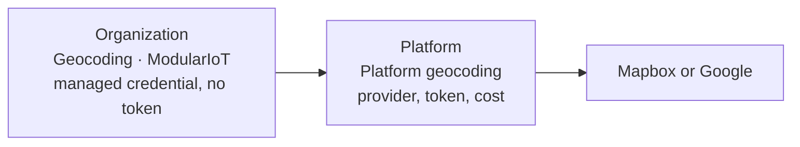

# The provider as a connection

**For:** implementers and developers.

The geocoding provider is a connection of type **Geocoding**, like any other integration. Two connections are involved.

| Connection | Where | Stores | Created by |
| --- | --- | --- | --- |
| **Platform geocoding** | Platform scope | Provider, credential with the token, permanent mode and cost per call | A platform owner |
| **Geocoding · ModularIoT** | Each organization | A managed credential, with no secret | A platform owner, from the organization |

When an organization needs the provider:

1. The platform checks that the organization has its managed connection.
2. It takes the provider, the token and the cost from the platform connection.
3. It calls the provider. The token never leaves the server and is sent only to the provider's host.

## Why two connections

| With two connections | Result |
| --- | --- |
| The organization does not see the token | Only the platform manages the token |
| Changing the token or the provider | Done once, on the platform, for all |
| Turning geocoding on or off for an organization | Its connection is added or deleted |
| The cost the platform pays | It stays in each usage row, separate from what the organization pays |

## If an organization brings its own credential

Not possible today. An organization geocoding connection that is not the managed one is refused (`geocoding: this organization's geocoding connection is not managed by the platform`), and connecting the managed one deletes it. The organization always uses the platform's provider and its quota.

## The credential's cost

| Platform connection field | Effect |
| --- | --- |
| `costPerRequestUsd` | It is copied into each provider call (`cost_usd`) and adds up to **Provider cost** in Platform › Geocoding › Organizations |
| `permanent` (Mapbox) | With `true`, Mapbox allows storing the point and the platform uses it and stores it in the cache. With `false`, no result is used |

How to set it up in [Set up the provider](/en/products/geocoding/how-to/set-up-provider).
