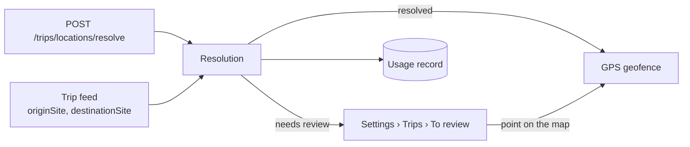

import { Callout, Cards } from 'nextra/components'

# Geocoding

**For:** everyone. If you are deciding whether to use the product, read this whole page.

ModularIoT geocoding turns the place a trip declares into a point on the map and a GPS geofence. The place can come as a geofence code, a Plus Code, coordinates or an address. With the geofence, the platform detects when the truck arrives at the origin or the destination.

## What it solves

A trip says where it leaves from and where it goes. If that place has no geofence, the platform cannot see the arrival or the departure. Without geocoding, someone has to draw each geofence by hand.

With geocoding:

| Before | Now |
| --- | --- |
| Each new place waits for someone to draw its geofence | The place is located when the trip arrives |
| A misspelled address leaves the trip untracked and nobody notices | The place goes to **To review** with the reason |
| Each call to a map service costs money, and nobody knows how many are made | Each resolution is recorded with its source and its cost |

## How a place is located

The platform tries sources in order and keeps the first one that gives a point. The first ones are free. Only the last one costs money.

| Order | Source | Example input | Cost |
| --- | --- | --- | --- |
| 1 | Existing geofence, by code or name | `CD-01` | Free |
| 2 | Plus Code | `57V4VXHC+H4`, or `VXHC+H4` with the district | Free |
| 3 | Coordinates | `-33.4569, -70.5976` | Free |
| 4 | Internal addresses (Chile only today) | `Av. Providencia 1208` | Free |
| 5 | Cache of earlier results | An address already looked up | Free |
| 6 | Provider (Mapbox or Google) | A new address | One call, within the quota |

Then the platform checks that the point falls in the declared district, with 500 m of tolerance. If it does, it uses the geofence that already contains the point or creates a circular geofence. If it does not, or if no source gave a point, the place goes to **To review**. A person places it on a map.

Step by step in [How the source is chosen](/en/products/geocoding/tutorials/resolution-order).

## What it costs

Only a call to the provider counts. Geofences, Plus Codes, coordinates, internal addresses and the cache use no quota.

| Item | Who sets it | Where |
| --- | --- | --- |
| Cost per call that the provider charges the platform | The contract with the provider | Settings › Connections, in the Platform scope |
| Monthly plan price, included calls and price per call over the quota | The platform owner | Settings › Platform › Geocoding › Plan |
| Each organization's quota and what happens when it runs out | The platform owner | Settings › Platform › Geocoding › Organizations |

A place is located once. Later trips to the same place use its geofence and make no new call. So the cost per trip goes down over time:

| Situation | Provider calls per trip |
| --- | --- |
| Origin and destination already located | 0 |
| New destination with an address in the internal addresses or in the cache | 0 |
| New destination with an address nobody looked up before | 1 |
| New origin and destination, both with new addresses | 2 |

Each organization sees its month's usage in **Settings › Trips › Monthly usage**. Details in [Usage, cost and monitoring](/en/products/geocoding/concepts/usage-and-cost).

## What depends on the country

The source order, the cache, the quota and the API are the same in every country. Each country also needs its administrative boundaries (communes or districts) and, where they exist, its address sources.

| Country | Administrative boundaries | Internal addresses | Provider |
| --- | --- | --- | --- |
| Chile | Communes | Yes (OpenAddresses) | Mapbox |
| Peru | Districts | No | Mapbox. Not certified: many addresses go to review |
| Others | No | No | Every place goes to review |

<Callout type="warning">
**Pitfall:** a place with no country, or from a country without administrative boundaries, always goes to review, even with coordinates or a geofence code. The district check requires them.
</Callout>

How to add a country in [Certify a new country](/en/products/geocoding/how-to/certify-a-country).

## Risks

| Risk | Effect | Where it shows |
| --- | --- | --- |
| The provider returns a wrong point inside the right district | The geofence is in the wrong place and the arrival is not detected | The trip does not change stage on arrival. Fix it in Locations |
| The provider does not find the exact address (only the street or the city) | The place goes to review | Settings › Trips › To review |
| The organization uses up its quota | Depending on its plan: places go to review, or each call is charged as overage | Monthly usage, and an alert at the plan's percentage |
| Two of the customer's geofences contain the point | The one with the lowest id is used | No warning |

## Choose your path

| You are | You want | Start at |
| --- | --- | --- |
| Product owner or customer | Know what it does, what it costs and its risks | This page and [Usage, cost and monitoring](/en/products/geocoding/concepts/usage-and-cost) |
| Implementer | Set up the provider and the quota, prepare the spreadsheet and review locations | [Set up the provider](/en/products/geocoding/how-to/set-up-provider) |
| Developer | Locate places through the API | [Your first location](/en/products/geocoding/tutorials/first-location) |

<Cards>
  <Cards.Card title="Your first location" href="/en/products/geocoding/tutorials/first-location" arrow />
  <Cards.Card title="How the source is chosen" href="/en/products/geocoding/tutorials/resolution-order" arrow />
  <Cards.Card title="Set up the provider" href="/en/products/geocoding/how-to/set-up-provider" arrow />
  <Cards.Card title="Locations API" href="/en/products/geocoding/reference/locations-api" arrow />
</Cards>

## Where a place comes in

| Input | Who uses it |
| --- | --- |
| `POST /api/v1/orgs/{org}/trips/locations/resolve` | A system that registers places through the API |
| The `originSite` and `destinationSite` sites of the trip feed | An integration that sends trips, for example from a spreadsheet |
| Manual review | A person who places the point on the map |

## How this guide is organized

| Section | Content |
| --- | --- |
| Learn | Short pages, in order, with input and output examples |
| How-to guides | One task: set up the provider, assign a quota, review locations |
| Concepts | What is generic and what depends on each setup; the provider; the cost |
| Reference | Every endpoint, field, review reason, table and metric |
