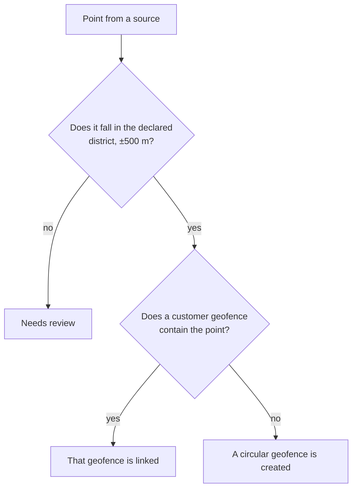

import { Callout } from 'nextra/components'

# From point to geofence

**For:** developers and implementers.

<Callout type="info">
**You will learn:**

- how the platform checks that the point falls in the declared district;
- when the place uses an existing geofence and when one is created;
- what radius the geofence has for each place type;
- what each resolution records.
</Callout>

A source gave a point. Before trips use it, two things happen: the district check and the choice of geofence.



## The declared district

Each site declares its country and its district (a commune in Chile, a district in Peru). The platform uses that data to check the point. Without it, the place needs review even if the point is correct.

| Data | Format | Example |
| --- | --- | --- |
| `country` | ISO 3166-1 alpha-2, case-insensitive | `CL`, `pe` |
| `districtCode` | Chile: commune code (CUT, 5 digits). Peru: ubigeo (6 digits) | `13101`, `150122` |
| `district` | The name, ignoring case, accents and repeated spaces | `Ñuñoa`, `nunoa` |

If you send both, `districtCode` wins. A code that lost its leading zeros is completed: `2101` is `02101` (Antofagasta). A name that repeats in the country does not work; send the code.

| Situation | Review note |
| --- | --- |
| No country | `country is required to check the district` |
| Country without administrative boundaries (any except CL and PE) | `country AR has no district boundaries` |
| No district | `district is required` |
| Code that does not exist | `district code 99999 not found in CL` |
| Name that repeats | `district Santa Rosa is ambiguous in PE; send its code` |
| District without a polygon in the boundary data | `district 150137 has no boundary to check against` |

## The 500-meter rule

The point must fall inside the district or 500 m or less from its border. The district polygons are simplified, and a real point next to the border can fall just outside.

If the point falls farther away, the place needs review. The note says where it fell:

```text
the point is in Santiago (13101), not in Providencia (13123)
```

If the point falls outside the country: `the point is outside CL, not in Santiago (13101)`.

The point is stored anyway in `latitude`, `longitude` and `plusCode`. The person who reviews the place sees it on the map.

## The geofence that already contains the point

If the point passes the check, the platform searches the organization's GPS geofences for one that contains the point. If it finds one, it links the place to it and does not create another.

| Rule | Detail |
| --- | --- |
| Only geofences of the same organization | Geofences of other organizations are never used |
| Several geofences contain the point | The one with the lowest identifier is used |
| Not considered | Geofences created when a place is placed by hand during review |
| Does not apply | To a point placed by hand: that place gets its own geofence |

If the search fails (for example, the GPS database does not respond), the place needs review with the note `could not check geofences for the point`.

<Callout type="warning">
**Pitfall:** the search for the geofence that contains the point arrives after version 0.6.0 of the platform. In version 0.6.0, each place resolved by Plus Code, coordinates or address gets a new geofence, even if another one already covers the point.
</Callout>

## The circular geofence

If no geofence contains the point, the platform creates a circle around the point. The radius depends on the place type:

| Type (`type`) | Radius |
| --- | --- |
| `port` | 1000 m |
| `plant` | 500 m |
| `distribution_center` | 300 m |
| `zone` | 200 m |
| `customer` | 150 m |

A place with no type, or one the feed created with only a code, is `zone`: 200 m.

The new geofence is stored in the organization's GPS database:

| Attribute | Value |
| --- | --- |
| Code | The place's `externalCode`. Without a code, its `id` |
| Name | The place's `name` |
| Shape | A polygon with 32 vertices |
| Properties | `created_by: miot-trips`, `location_id`, `location_type`, `resolution_source`, `plus_code` |

Because the geofence code is the `externalCode`, a second resolution of the same place finds it by code (source 1) and does not create another. A customer geofence that already contained the point keeps its own code: on a second resolution source 1 does not find it, and the containment search chooses it again.

If the organization has no GPS database configured, the geofence cannot be created and the place needs review with the note `the GPS database is not configured`.

## What is recorded

| Where | What |
| --- | --- |
| The location | The point, the Plus Code, the source, the status, the note and the geofence |
| Trips audit log | A `location.resolved` or `location.needs_review` entry, with the source and the geofence |
| Geocoding usage record | One row per `POST /resolve` or feed site: source, result, provider, whether it was a cache hit and the cost. Placing by hand and rejecting write no row |
| Open trips at that place | They are recalculated, so they use the new geofence |

The details of each record are in [Data and metrics](/en/products/geocoding/reference/data-and-metrics).

## Summary

- The point must fall in the declared district, with 500 m of tolerance. If not, the place needs review.
- If a geofence of the organization contains the point, that one is used.
- If not, a circle is created with the radius of the place type.
- The code of a created geofence is the place's `externalCode`.

Next: [Locations that need review](/en/products/geocoding/tutorials/needs-review).
