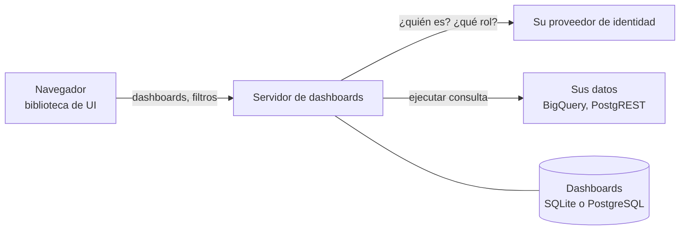

import { Callout, Cards } from 'nextra/components'

# Dashboards

**Para:** todos. Si decide si usar el producto, lea esta página completa.

ModularIoT Dashboards sirve para construir dashboards operacionales, compartirlos e incrustarlos en otra aplicación. Un dashboard es una grilla de widgets: números, barras, tortas, tablas y texto. Cada widget lee el resultado de una consulta a sus datos.

## Qué hace

| Capacidad | Qué significa |
| --- | --- |
| Editor de grilla | Arrastre y cambie el tamaño de los widgets en una grilla de 24 columnas. Los cambios se guardan solos. |
| Widgets | Texto, indicadores (KPI), barras apiladas, gráficos de barras, líneas, torta e indicador, tablas y listas. |
| Consultas | Cada widget lee una consulta guardada. Las consultas SQL se escriben y prueban en un editor (BigQuery) o se exponen como funciones (PostgREST). |
| Filtros | Texto, rango de fechas y selección. Un filtro cambia los parámetros de las consultas que lo usan. |
| Permisos | Cuatro roles por ámbito y roles adicionales por dashboard, para personas o grupos. |
| Organizaciones | Los dashboards y los datos de cada organización están separados. |
| Incrustar | Muestre dashboards en su aplicación con React, un Web Component o cualquier página HTML, incluida Phoenix LiveView. |
| Importar y exportar | Copie un dashboard entre entornos como un archivo JSON. |

El navegador nunca recibe credenciales, URL de datos ni SQL. El dashboard nombra una consulta; el servidor la ejecuta.

## Usos típicos

| Uso | Widgets |
| --- | --- |
| Estado de una operación: cuántos registros hay en cada estado | Stacked Stat (KPI por estado + barra 100 %), Data Table |
| Tendencia diaria o mensual | Chart v2 (líneas o barras por fecha) |
| Ranking: los 10 con más eventos | Chart v2 (barra horizontal) |
| Avance contra una meta | Progress Stat, Progress |
| Detalle para revisar fila por fila | Data Table con filtros por columna y exportación a CSV |

## Qué no hace todavía

| Límite | Alternativa |
| --- | --- |
| Hacer clic en un gráfico no filtra otros widgets. | Agregue un filtro de selección al dashboard y vincúlelo al parámetro de la consulta de la tabla. |
| Los widgets de un solo valor (Stat, Stacked Stat) leen solo la primera fila de la consulta. | Escriba la consulta para que devuelva una fila, con una columna por valor. |
| Un gráfico de torta no asigna un color fijo a cada categoría. Toma los colores de la paleta en el orden de las filas. | Ordene las filas en la consulta y defina los colores personalizados en ese orden. |
| El editor de SQL solo funciona con BigQuery. | Con PostgreSQL, escriba la consulta como una función y publíquela con PostgREST. |
| Los paneles de ajustes de los widgets son componentes React. | Un host que no usa React construye sus propios formularios de ajustes. |
| Mapas, contenedores y carga de archivos solo existen en la aplicación de ModularIoT. | — |

## Elija su camino

| Usted es | Quiere | Empiece en |
| --- | --- | --- |
| Responsable de producto o cliente | Saber qué hace y qué no | Esta página y [Elegir su camino](/es/products/dashboards/getting-started/choose-a-setup) |
| Implementador | Construir dashboards en la interfaz: datos, consultas, widgets, filtros, permisos | [Construir su primer dashboard](/es/products/dashboards/tutorials/first-dashboard) |
| Desarrollador | Incrustar dashboards en su aplicación y operar el servidor | [Inicio rápido](/es/products/dashboards/getting-started/quickstart), luego [Incrustar un dashboard en una página web](/es/products/dashboards/tutorials/embed-in-a-web-page) |

<Cards>
  <Cards.Card title="Elegir su camino" href="/es/products/dashboards/getting-started/choose-a-setup" arrow />
  <Cards.Card title="Construir su primer dashboard" href="/es/products/dashboards/tutorials/first-dashboard" arrow />
  <Cards.Card title="Incrustar un dashboard en una página web" href="/es/products/dashboards/tutorials/embed-in-a-web-page" arrow />
  <Cards.Card title="Catálogo de widgets" href="/es/products/dashboards/reference/widgets" arrow />
</Cards>

## Cómo encajan las partes

El navegador pide al servidor un dashboard y los resultados de sus consultas. El servidor revisa quién pregunta y qué permite su rol. Luego ejecuta la consulta con credenciales que el navegador no ve. Detalles en [Arquitectura](/es/products/dashboards/concepts/architecture).

## Los tres paquetes

Tres paquetes npm de código abierto, licencia Apache 2.0.

| Paquete | Versión | Función |
| --- | --- | --- |
| [`@microboxlabs/miot-dashboard-server`](/es/products/dashboards/reference/server-library) | 0.8.0 | Guarda dashboards, revisa cada solicitud y ejecuta las consultas. |
| [`@microboxlabs/miot-dashboard-ui`](/es/products/dashboards/reference/ui-library) | 0.1.2 | Dibuja y edita dashboards en el navegador. |
| [`@microboxlabs/miot-dashboard-contract`](/es/products/dashboards/reference/contract) | 0.6.0 | Formato del documento, roles, errores y la definición OpenAPI. |

El servidor también se distribuye como imagen de contenedor y como chart de Helm. Vea [Instalación](/es/products/dashboards/getting-started/installation).

## Cómo está organizada esta guía

| Sección | Contenido |
| --- | --- |
| Primeros pasos | Elegir un camino, ejecutar el servidor por primera vez |
| Aprender | Páginas cortas, en orden, con ejemplos: primer dashboard, consultas, incrustar |
| Guías prácticas | Una tarea concreta: agregar un filtro, conectar BigQuery |
| Conceptos | Cómo funcionan las partes |
| Despliegue | Producción y actualizaciones |
| Referencia | Cada widget, ajuste, ruta de la API y límite |

<Callout type="info">
Las páginas que muestran la interfaz de ModularIoT lo dicen en la primera línea ("configuración de ModularIoT"). El resto vale para cualquier aplicación que use las bibliotecas.
</Callout>
