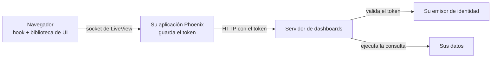

import { Callout, Steps } from 'nextra/components'

# Incrustar en Phoenix LiveView

**Para:** desarrolladores. **Configuración:** una aplicación Phoenix LiveView propia, con el servidor de dashboards aparte.

<Callout type="info">
**Aprenderá a:**

- llamar al servidor de dashboards desde Elixir, con el token o ticket de la persona;
- cargar la biblioteca de UI sin React en su código;
- dibujar el dashboard desde un hook de LiveView;
- ejecutar las consultas guardadas sin que el navegador vea el token;
- guardar cambios de posición, aplicar filtros y activar el modo edición.
</Callout>

## Cómo encajan las partes



| Parte | Hace |
| --- | --- |
| Su aplicación Phoenix | Inicia la sesión, guarda el token en la sesión cifrada y llama al servidor de dashboards |
| El LiveView | Tiene el documento del dashboard, responde a los eventos del hook y guarda |
| El hook de JavaScript | Dibuja el dashboard con `mountDashboard` y envía al LiveView las consultas y los cambios de posición |
| El servidor de dashboards | Valida el token, decide los permisos y ejecuta las consultas |

El navegador nunca recibe el token. Las consultas viajan por el socket de LiveView.

## Antes de empezar

| Necesita | Vea |
| --- | --- |
| El servidor de dashboards con autenticación por JWT o por ticket | [Autenticar usuarios](/es/products/dashboards/how-to/authenticate-users) |
| Una organización y un ámbito con al menos un dashboard | [Inicio rápido](/es/products/dashboards/getting-started/quickstart) |
| Phoenix 1.7 o posterior con LiveView y `Req` | — |

<Steps>

### Llamar al servidor desde Elixir

Un módulo envía cada solicitud con el token de la persona. Las rutas llevan la organización (`tenant`) y el ámbito (`scope`).

```elixir filename="lib/my_app/dashboards.ex"
defmodule MyApp.Dashboards do
  @header "authorization" # o el encabezado de MIOT_DASHBOARD_TICKET_HEADER

  defp request(token, method, path, opts \\ []) do
    {headers, opts} = Keyword.pop(opts, :headers, [])
    Req.request([
      method: method,
      url: Application.fetch_env!(:my_app, :dashboard_url) <> path,
      headers: [{@header, token} | headers],
      retry: false
    ] ++ opts)
  end

  defp path(tenant, scope, slug),
    do: "/tenants/#{URI.encode_www_form(tenant)}/scopes/#{URI.encode_www_form(scope)}/dashboards/#{URI.encode_www_form(slug)}"

  def load(token, tenant, scope, slug) do
    case request(token, :get, path(tenant, scope, slug)) do
      {:ok, %{status: 200, body: %{"data" => doc}} = r} ->
        {:ok, doc, List.first(Req.Response.get_header(r, "etag"))}
      {:ok, %{status: status}} -> {:error, status}
      {:error, _} -> {:error, 503}
    end
  end

  def save(token, tenant, scope, slug, doc, etag) do
    case request(token, :put, path(tenant, scope, slug), json: doc, headers: [{"if-match", etag}]) do
      {:ok, %{status: 200} = r} -> {:ok, List.first(Req.Response.get_header(r, "etag"))}
      {:ok, %{status: status}} -> {:error, status}
      {:error, _} -> {:error, 503}
    end
  end

  def run_query(token, tenant, scope, slug, query_id, filters) do
    case request(token, :post, path(tenant, scope, slug) <> "/queries/#{URI.encode_www_form(query_id)}",
           json: %{filters: filters}) do
      {:ok, %{status: 200, body: %{"data" => %{"rows" => rows}}}} -> {:ok, rows}
      {:ok, %{status: status}} -> {:error, status}
      {:error, _} -> {:error, 503}
    end
  end
end
```

Con JWT, el valor del encabezado es `Bearer <token>`. Con ticket, use el encabezado y el formato que configuró en el servidor (`MIOT_DASHBOARD_TICKET_HEADER`, `MIOT_DASHBOARD_TICKET_SCHEME`).

Cada guardado envía la revisión (`If-Match`). Si otra persona guardó antes, el servidor responde `409`: vuelva a cargar el documento. Para crear un dashboard, guarde con `If-Match: "0"`.

### Guardar el token en la sesión

El token se guarda en la sesión del servidor y se revisa en cada montaje del LiveView.

```elixir filename="lib/my_app_web/endpoint.ex"
@session_options [
  store: :cookie,
  key: "_my_app_key",
  signing_salt: "…",
  encryption_salt: "…",
  same_site: "Lax"
]
```

```elixir filename="lib/my_app_web/live/auth.ex"
defmodule MyAppWeb.Live.Auth do
  import Phoenix.Component
  import Phoenix.LiveView

  def on_mount(:require_token, _params, %{"token" => token}, socket) when is_binary(token),
    do: {:cont, assign(socket, token: token)}

  def on_mount(:require_token, _params, _session, socket),
    do: {:halt, redirect(socket, to: "/login")}
end
```

Con `encryption_salt`, la cookie va cifrada además de firmada. Agregue el nombre del parámetro del token a `filter_parameters` para que no llegue a los logs.

### Servir la biblioteca de UI

Copie tres archivos a `priv/static/vendor/`. Fije las versiones.

| Archivo | Origen |
| --- | --- |
| `dashboard-runtime.js` | `@microboxlabs/miot-dashboard-ui/dist/browser/browser-charts.js` |
| `dashboard.css` | `@microboxlabs/miot-dashboard-ui/styles.css` |
| `echarts.js` | La build ESM de ECharts 6 (`echarts/dist/echarts.esm.min.js`) |

```bash
npm pack @microboxlabs/miot-dashboard-ui@0.1.2
tar -xzf microboxlabs-miot-dashboard-ui-0.1.2.tgz
cp package/dist/browser/browser-charts.js priv/static/vendor/dashboard-runtime.js
cp package/styles.css priv/static/vendor/dashboard.css
```

`browser-charts.js` trae React adentro y no necesita compilación. Si no usa gráficos, use `browser.js`: es más liviano y no necesita ECharts.

Cargue el CSS en el layout:

```heex filename="lib/my_app_web/components/layouts/root.html.heex"
<link rel="stylesheet" href={~p"/vendor/dashboard.css"} />
```

### Escribir el hook

El hook arma el registro de widgets, monta el dashboard y conecta los eventos con el LiveView.

```js filename="assets/js/dashboard_canvas.js"
// Rutas en variables: así esbuild no intenta empaquetar los archivos.
const runtimeUrl = "/vendor/dashboard-runtime.js"
const echartsUrl = "/vendor/echarts.js"
const runtime = () => import(runtimeUrl)
const echarts = () => import(echartsUrl)

const labels = {
  loadingLabel: "Cargando…",
  errorLabel: "No se pudieron cargar los datos.",
  unsupportedDataLabel: "Este widget necesita una consulta guardada.",
}

let registryPromise
function registry() {
  registryPromise ??= Promise.all([runtime(), echarts()]).then(([ui, ec]) => {
    const definitions = [
      ...ui.createStackedStatRegistry({ ...labels, defaultTitle: "Distribución", defaultUnit: "", emptyLabel: "Sin elementos" }).all(),
      ...ui.createIconStatRegistry({ ...labels, defaultTitle: "Total" }).all(),
      ...ui.createChartRegistry({
        ...labels,
        defaultTitle: "Gráfico",
        emptyLabel: "Sin datos",
        rangeLabels: { all: "Todo", "7d": "7D", "30d": "30D", "90d": "3M", "180d": "6M", "1y": "1A" },
        createEngine: (element) => {
          const chart = ec.init(element)
          return {
            update: (option) => chart.setOption(option, { notMerge: true }),
            resize: () => chart.resize(),
            dispose: () => chart.dispose(),
          }
        },
      }).all(),
      // Agregue aquí los demás registros que use: tablas, textos, etc.
    ]
    return { ui, registry: { get: (id) => definitions.find((d) => d.meta.id === id) } }
  })
  return registryPromise
}

export const DashboardCanvas = {
  async mounted() {
    const { ui, registry: widgets } = await registry()
    const client = {
      key: () => this.el.dataset.key,
      query: (_slug, queryId, filters) =>
        new Promise((resolve, reject) =>
          this.pushEvent("run_query", { queryId, filters }, (reply) =>
            reply.error ? reject(new Error(reply.error)) : resolve(reply.rows))),
    }
    const options = (canvas) => ({
      instanceKey: this.el.dataset.key,
      registry: widgets,
      widgets: canvas.widgets,
      unknownWidgetLabel: "Este widget no está disponible.",
      editMode: canvas.edit,
      onLayoutCommit: (layout) => this.pushEvent("layout_commit", { layout }),
      savedQueries: {
        client,
        slug: this.el.dataset.key,
        queries: canvas.queries,
        filters: canvas.filters,
        refreshIntervalMs: 0,
        paused: false,
        errorMessage: labels.errorLabel,
      },
    })
    const target = document.createElement("div")
    this.el.replaceChildren(target)
    this.mount = ui.mountDashboard(target, options(JSON.parse(this.el.dataset.canvas)))
    this.handleEvent("dashboard:render", (canvas) => this.mount.update(options(canvas)))
  },
  destroyed() {
    this.mount?.destroy()
  },
}
```

```js filename="assets/js/app.js"
import { DashboardCanvas } from "./dashboard_canvas"
const liveSocket = new LiveSocket("/live", Socket, { hooks: { DashboardCanvas }, params: { _csrf_token: csrfToken } })
```

| Parte | Hace |
| --- | --- |
| `this.el.replaceChildren(target)` | `mountDashboard` exige un elemento vacío. Si no lo está, lanza `occupied-container` |
| `instanceKey` estable | Cambiarlo descarta el estado de los widgets. Los filtros nuevos llegan con `update` |
| `query` con `pushEvent` y respuesta | La consulta la ejecuta el LiveView con el token. El navegador solo recibe filas |
| `destroy()` en `destroyed()` | Libera React y los gráficos al salir de la página |

### Escribir el LiveView

El LiveView carga el documento, entrega el estado al hook y responde a sus eventos.

```elixir filename="lib/my_app_web/live/dashboard_live.ex"
defmodule MyAppWeb.DashboardLive do
  use MyAppWeb, :live_view
  on_mount {MyAppWeb.Live.Auth, :require_token}
  alias MyApp.Dashboards

  def mount(%{"tenant" => tenant, "scope" => scope, "slug" => slug}, _session, socket) do
    {:ok, doc, etag} = Dashboards.load(socket.assigns.token, tenant, scope, slug)
    {:ok, assign(socket, tenant: tenant, scope: scope, slug: slug, doc: doc, etag: etag, filters: %{}, edit: false)}
  end

  defp canvas(a), do: %{widgets: a.doc["widgets"] || [], queries: a.doc["queries"] || [], filters: a.filters, edit: a.edit}
  defp redraw(socket), do: push_event(socket, "dashboard:render", canvas(socket.assigns))

  def render(assigns) do
    ~H"""
    <button phx-click="toggle_edit">{if @edit, do: "Listo", else: "Editar"}</button>
    <div
      id={"canvas-#{@tenant}-#{@scope}-#{@slug}"}
      phx-hook="DashboardCanvas"
      phx-update="ignore"
      data-key={"#{@tenant}/#{@scope}/#{@slug}"}
      data-canvas={Jason.encode!(canvas(assigns))}
    />
    """
  end

  def handle_event("run_query", %{"queryId" => id, "filters" => filters}, socket) do
    a = socket.assigns
    case Dashboards.run_query(a.token, a.tenant, a.scope, a.slug, id, filters) do
      {:ok, rows} -> {:reply, %{rows: rows}, socket}
      {:error, _} -> {:reply, %{error: "No se pudieron cargar los datos."}, socket}
    end
  end

  def handle_event("layout_commit", %{"layout" => items}, socket) do
    positions = Map.new(items, &{&1["i"], Map.take(&1, ~w(x y w h))})
    widgets =
      for w <- socket.assigns.doc["widgets"] || [] do
        case positions[w["id"]] do
          nil -> w
          p -> %{w | "layout" => Map.merge(w["layout"], p)}
        end
      end
    {:noreply, save(socket, Map.put(socket.assigns.doc, "widgets", widgets))}
  end

  def handle_event("toggle_edit", _, socket),
    do: {:noreply, socket |> update(:edit, &(!&1)) |> redraw()}

  defp save(socket, doc) do
    a = socket.assigns
    case Dashboards.save(a.token, a.tenant, a.scope, a.slug, doc, a.etag) do
      {:ok, etag} -> assign(socket, doc: doc, etag: etag)
      {:error, 409} -> put_flash(socket, :error, "Otra persona guardó este dashboard. Recargue.")
      {:error, _} -> put_flash(socket, :error, "No se pudo guardar.")
    end
  end
end
```

`phx-update="ignore"` impide que LiveView reemplace el contenido del `div`. El dashboard se actualiza solo con el evento `dashboard:render`.

### Aplicar filtros

Guarde los valores de los filtros en el LiveView y envíelos con `redraw/1`. Las consultas que vinculan esos filtros se vuelven a ejecutar.

```elixir
def handle_event("apply_filters", %{"filters" => values}, socket) do
  filters = values |> Enum.reject(fn {_k, v} -> v == "" end) |> Map.new()
  {:noreply, socket |> assign(filters: filters) |> redraw()}
end
```

Los filtros se definen en el documento (`filters`). El formulario de la barra de filtros es suyo: la biblioteca no trae uno sin React. Un rango de fechas entrega `<clave>_from` y `<clave>_to`. Vea [Agregar filtros](/es/products/dashboards/how-to/add-filters).

</Steps>

## Modo edición y ajustes de widgets

En modo edición (`editMode: true`), la grilla permite mover y cambiar el tamaño de los widgets y llama a `onLayoutCommit`. Lo demás lo construye usted:

| Necesita | La biblioteca sin React | Usted construye |
| --- | --- | --- |
| Botones por widget (ajustes, duplicar, eliminar) | No los dibuja. `Frame` acepta solo un componente React | Botones propios sobre cada `.miot-widget`, y un evento hacia el LiveView. El `id` de cada `.miot-widget` termina en `-widget-<id del widget>` |
| Formulario de ajustes de cada widget | No | Formularios en LiveView. Las claves de cada widget están en la [referencia de widgets](/es/products/dashboards/reference/widgets) |
| Editor de consultas guardadas | No | Un formulario que agregue `{id, variableName, connectionId, operationId, parameters}` a `queries`. El catálogo está en `GET …/dashboards/{slug}/query-catalog` |
| Permisos | No | Formulario sobre `…/dashboards/{slug}/permissions` |
| Guardado automático con deshacer | No | Guarde en cada cambio, o acumule y guarde con un temporizador |

## Tema e idioma

| Qué | Cómo |
| --- | --- |
| Colores de las tarjetas | Variables CSS: `--miot-card-background`, `--miot-card-border`, `--miot-card-text`, `--miot-card-muted`, `--miot-accent`, `--miot-focus-color`, `--miot-progress-color` |
| Modo oscuro de los gráficos | `darkMode` en `createChartRegistry`. Se lee al crear el registro: para cambiarlo, vuelva a crear el registro y a montar |
| Textos | Cada registro recibe sus etiquetas (`loadingLabel`, `defaultTitle`, …). La biblioteca no trae traducciones |

<Callout type="warning">
**Cuidado:** si su CSS no usa Tailwind, agregue `.miot-widget { position: relative; }`. Sin esa regla, los botones propios que posicione sobre el widget quedan fuera de lugar.
</Callout>

## LiveView y la configuración de ModularIoT

| Capacidad | Configuración de ModularIoT | Phoenix LiveView |
| --- | --- | --- |
| Inicio de sesión y token | La aplicación web | Su aplicación Phoenix |
| Dibujar el dashboard y la grilla | Biblioteca (React) | Biblioteca (`mountDashboard`) |
| Gráficos | Biblioteca y ECharts | Biblioteca y ECharts que usted sirve |
| Formularios de ajustes de cada widget | Hechos por la aplicación | Hechos por usted |
| Consultas guardadas | Editor de la biblioteca (React) | Formulario propio |
| Editor de SQL de BigQuery | Editor de la biblioteca (React) | Propio, o use la API de consultas del servidor |
| Barra de filtros | Hecha por la aplicación | Hecha por usted |
| Permisos | Editor de la biblioteca (React) | Formulario propio |
| Guardado automático y deshacer | Sí | Usted decide cuándo guardar |
| Importar y exportar | Sí | El documento es JSON: descárguelo con `load/4` |
| Mapas, contenedores, carga de archivos | Sí | No existen en la biblioteca |
| Modo oscuro | Sí | Solo gráficos, con `darkMode` |

La falta de formularios sin React está registrada en [#2239](https://github.com/microboxlabs/modulariot/issues/2239).

## Errores comunes

| Síntoma | Causa | Solución |
| --- | --- | --- |
| `Dashboard mount: occupied-container` | El elemento no estaba vacío | `this.el.replaceChildren(target)` antes de montar |
| El dashboard desaparece tras un evento | LiveView reemplazó el `div` | `phx-update="ignore"` en el `div` del hook |
| Los widgets muestran "No se pudieron cargar los datos." | `run_query` respondió `error` | Revise el log del LiveView y el estado HTTP del servidor |
| Un widget dice "Este widget no está disponible." | Su registro no incluye ese `componentId` | Agregue su función de registro |
| Guardar responde `409` | Otra persona guardó antes | Vuelva a cargar el documento y la revisión |
| Los gráficos no aparecen | Usó `browser.js` o no sirvió ECharts | Use `browser-charts.js` y entregue `createEngine` |

## Relacionado

- [Incrustar un dashboard en una página web](/es/products/dashboards/tutorials/embed-in-a-web-page)
- [API REST](/es/products/dashboards/reference/rest-api)
- [Biblioteca de UI](/es/products/dashboards/reference/ui-library)
