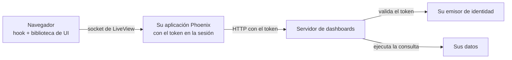

import { Callout, Steps } from 'nextra/components'

# Incrustar en Phoenix LiveView

**Para:** desarrolladores. **Configuración:** una aplicación Phoenix LiveView propia, con el servidor de dashboards aparte.

<Callout type="info">
**Aprenderá a:** llamar al servidor de dashboards desde Elixir, cargar la biblioteca de UI sin React, dibujar el dashboard desde un hook y ejecutar las consultas guardadas sin que el JavaScript de la página vea el token.
</Callout>

## Componentes



| Parte | Hace |
| --- | --- |
| Su aplicación Phoenix | Inicia la sesión, guarda el token en la cookie de sesión cifrada y llama al servidor de dashboards |
| El LiveView | Tiene el documento del dashboard, responde a los eventos del hook y guarda |
| El hook de JavaScript | Dibuja el dashboard con `mountDashboard` y envía al LiveView las consultas y los cambios de posición |
| El servidor de dashboards | Valida el token, decide los permisos y ejecuta las consultas |

El hook envía las consultas por el socket de LiveView. El JavaScript de la página nunca ve el token.

## Antes de empezar

| Necesita | Vea |
| --- | --- |
| El servidor de dashboards con autenticación por JWT o por ticket | [Autenticar usuarios](/es/products/dashboards/how-to/authenticate-users) |
| Una organización y un ámbito con al menos un dashboard | [Inicio rápido](/es/products/dashboards/getting-started/quickstart) |
| Phoenix 1.7 o posterior, LiveView 1.0 o posterior | — |
| `{:req, "~> 0.5"}` en `mix.exs` | — |

<Steps>

### Configurar la dirección del servidor

```elixir filename="config/runtime.exs"
config :my_app, dashboard_url: System.fetch_env!("DASHBOARD_URL")
```

`DASHBOARD_URL` es la dirección base del servidor de dashboards, por ejemplo `http://dashboards:3070`.

### Iniciar sesión y guardar el token

Su login obtiene el token del emisor de identidad y lo guarda en la sesión:

```elixir filename="lib/my_app_web/controllers/session_controller.ex"
def create(conn, %{"token" => token}) do
  conn
  |> configure_session(renew: true)
  |> put_session("token", token)
  |> redirect(to: ~p"/dashboards")
end
```

Cifre la cookie de sesión y deje el token fuera de los logs:

```elixir filename="lib/my_app_web/endpoint.ex"
@session_options [
  store: :cookie,
  key: "_my_app_key",
  signing_salt: "…",
  encryption_salt: "…",
  same_site: "Lax"
]
```

```elixir filename="config/config.exs"
config :phoenix, :filter_parameters, ["password", "token"]
```

Cada LiveView revisa que haya token:

```elixir filename="lib/my_app_web/live/auth.ex"
defmodule MyAppWeb.Live.Auth do
  import Phoenix.Component
  import Phoenix.LiveView

  def on_mount(:require_token, _params, %{"token" => token}, socket) when is_binary(token),
    do: {:cont, assign(socket, token: token)}

  def on_mount(:require_token, _params, _session, socket),
    do: {:halt, redirect(socket, to: "/login")}
end
```

```elixir filename="lib/my_app_web/router.ex"
live_session :dashboards, on_mount: {MyAppWeb.Live.Auth, :require_token} do
  live "/dashboards/:tenant/:scope/:slug", MyAppWeb.DashboardLive
end
```

`tenant` es el ID de la organización en el servidor de dashboards, no su nombre. `GET /tenants/{tenant}/scopes/{scope}/dashboards` lista los `slug` disponibles.

<Callout type="warning">
**Cuidado:** la cookie de sesión no puede pasar de 4096 bytes. Un JWT con muchos grupos, cifrado, puede acercarse a ese límite. Si pasa, guarde el token en el servidor (por ejemplo en ETS) y en la sesión solo una referencia.
</Callout>

### Llamar al servidor desde Elixir

```elixir filename="lib/my_app/dashboards.ex"
defmodule MyApp.Dashboards do
  # JWT: "authorization" con "Bearer <token>".
  # Ticket: el encabezado de MIOT_DASHBOARD_TICKET_HEADER, con el prefijo de MIOT_DASHBOARD_TICKET_SCHEME si lo hay.
  defp auth_header(token), do: {"authorization", "Bearer " <> token}

  defp request(token, method, path, opts \\ []) do
    {headers, opts} = Keyword.pop(opts, :headers, [])
    Req.request([
      method: method,
      url: Application.fetch_env!(:my_app, :dashboard_url) <> path,
      headers: [auth_header(token) | headers],
      retry: false
    ] ++ opts)
  end

  defp seg(value), do: URI.encode(value, &URI.char_unreserved?/1)
  defp path(tenant, scope, slug), do: "/tenants/#{seg(tenant)}/scopes/#{seg(scope)}/dashboards/#{seg(slug)}"
  defp etag(response), do: List.first(Req.Response.get_header(response, "etag"))

  def load(token, tenant, scope, slug) do
    case request(token, :get, path(tenant, scope, slug)) do
      {:ok, %{status: 200, body: %{"data" => doc}} = r} when is_map(doc) -> {:ok, doc, etag(r)}
      {:ok, %{status: 200}} -> {:error, 404}
      {:ok, %{status: status}} -> {:error, status}
      {:error, _} -> {:error, 503}
    end
  end

  def save(token, tenant, scope, slug, doc, revision) do
    case request(token, :put, path(tenant, scope, slug), json: doc, headers: [{"if-match", revision}]) do
      {:ok, %{status: 200} = r} -> {:ok, etag(r)}
      {:ok, %{status: status}} -> {:error, status}
      {:error, _} -> {:error, 503}
    end
  end

  def create(token, tenant, scope, slug, name) do
    doc = %{"version" => 2, "name" => name, "preferences" => %{"editMode" => false}, "widgets" => [], "queries" => []}
    save(token, tenant, scope, slug, doc, ~s("0"))
  end

  def run_query(token, tenant, scope, slug, query_id, filters) do
    case request(token, :post, path(tenant, scope, slug) <> "/queries/#{seg(query_id)}", json: %{filters: filters}) do
      {:ok, %{status: 200, body: %{"data" => %{"rows" => rows}}}} -> {:ok, rows}
      {:ok, %{status: status}} -> {:error, status}
      {:error, _} -> {:error, 503}
    end
  end
end
```

| Respuesta | Significa |
| --- | --- |
| `401` | El token no es válido o venció. Vuelva a iniciar la sesión |
| `403` | La persona no tiene permiso en esa organización o ámbito |
| `404` | El dashboard no existe. `create/5` lo crea con `If-Match: "0"` |
| `409` al guardar | Otra persona guardó antes. Vuelva a cargar el documento y su revisión |

### Servir la biblioteca de UI

Agregue `vendor` a las carpetas estáticas. Sin esto, Phoenix responde 404 a `/vendor/...`:

```elixir filename="lib/my_app_web.ex"
def static_paths, do: ~w(assets fonts images vendor favicon.ico robots.txt)
```

Copie tres archivos a `priv/static/vendor/`. Fije las versiones:

```bash
mkdir -p priv/static/vendor /tmp/dashui /tmp/echarts
npm pack @microboxlabs/miot-dashboard-ui@0.1.2 --pack-destination /tmp/dashui
tar -xzf /tmp/dashui/*.tgz -C /tmp/dashui
cp /tmp/dashui/package/dist/browser/browser-charts.js priv/static/vendor/dashboard-runtime.js
cp /tmp/dashui/package/styles.css priv/static/vendor/dashboard.css
npm pack echarts@6.1.0 --pack-destination /tmp/echarts
tar -xzf /tmp/echarts/*.tgz -C /tmp/echarts
cp /tmp/echarts/package/dist/echarts.esm.min.js priv/static/vendor/echarts.js
```

| Archivo | Contiene |
| --- | --- |
| `dashboard-runtime.js` | La biblioteca de UI con React incluido. No necesita compilación |
| `dashboard.css` | Los estilos de los widgets |
| `echarts.js` | ECharts 6 en formato ESM. Solo si usa gráficos |

Sin gráficos, copie `dist/browser/browser.js` en lugar de `browser-charts.js` y omita ECharts.

Cargue el CSS en el layout raíz:

```html filename="lib/my_app_web/components/layouts/root.html.heex"
<link rel="stylesheet" href={~p"/vendor/dashboard.css"} />
```

### Escribir el hook

```js filename="assets/js/dashboard_canvas.js"
// Rutas en variables: así esbuild no intenta empaquetar los archivos.
const runtimeUrl = "/vendor/dashboard-runtime.js"
const echartsUrl = "/vendor/echarts.js"

const labels = {
  loadingLabel: "Cargando…",
  errorLabel: "No se pudieron cargar los datos.",
  unsupportedDataLabel: "Este widget necesita una consulta guardada.",
}

let registryPromise
function registry() {
  registryPromise ??= Promise.all([import(runtimeUrl), import(echartsUrl)]).then(([ui, ec]) => {
    const definitions = [
      ...ui.createStackedStatRegistry({ ...labels, defaultTitle: "Distribución", defaultUnit: "", emptyLabel: "Sin elementos" }).all(),
      ...ui.createIconStatRegistry({ ...labels, defaultTitle: "Total" }).all(),
      ...ui.createChartRegistry({
        ...labels,
        defaultTitle: "Gráfico",
        emptyLabel: "Sin datos",
        rangeLabels: { all: "Todo", "7d": "7D", "30d": "30D", "90d": "3M", "180d": "6M", "1y": "1A" },
        createEngine: (element) => {
          const chart = ec.init(element)
          return {
            update: (option) => chart.setOption(option, { notMerge: true }),
            resize: () => chart.resize(),
            dispose: () => chart.dispose(),
          }
        },
      }).all(),
      // Agregue aquí los demás registros que use: tablas, textos, etc.
    ]
    return { ui, registry: { get: (id) => definitions.find((d) => d.meta.id === id) } }
  })
  return registryPromise
}

export const DashboardCanvas = {
  async mounted() {
    const { ui, registry: widgets } = await registry()
    if (this.gone) return
    const client = {
      key: () => this.el.dataset.key,
      query: (_slug, queryId, filters) =>
        new Promise((resolve, reject) =>
          this.pushEvent("run_query", { queryId, filters }, (reply) =>
            reply.error ? reject(new Error(reply.error)) : resolve(reply.rows))),
    }
    const options = (canvas) => ({
      instanceKey: this.el.dataset.key,
      registry: widgets,
      widgets: canvas.widgets,
      unknownWidgetLabel: "Este widget no está disponible.",
      editMode: canvas.edit,
      onLayoutCommit: (layout) => this.pushEvent("layout_commit", { layout }),
      savedQueries: {
        client,
        slug: this.el.dataset.key,
        queries: canvas.queries,
        filters: canvas.filters,
        refreshIntervalMs: 0,
        paused: false,
        errorMessage: labels.errorLabel,
      },
    })
    const target = document.createElement("div")
    this.el.replaceChildren(target)
    this.mount = ui.mountDashboard(target, options(JSON.parse(this.el.dataset.canvas)))
    this.handleEvent("dashboard:render", (canvas) => this.mount.update(options(canvas)))
  },
  destroyed() {
    this.gone = true
    this.mount?.destroy()
  },
}
```

```js filename="assets/js/app.js"
import { DashboardCanvas } from "./dashboard_canvas"
const liveSocket = new LiveSocket("/live", Socket, { hooks: { DashboardCanvas }, params: { _csrf_token: csrfToken } })
```

El hook usa `import()` dinámico. Compile con `--target=es2020` o posterior en la configuración de esbuild (`config/config.exs`). Con `es2017`, esbuild no puede dejar `import()` sin cambios.

| Parte | Hace |
| --- | --- |
| `this.el.replaceChildren(target)` | `mountDashboard` exige un elemento vacío. Si no lo está, lanza `occupied-container` |
| `instanceKey` estable | Cambiarlo descarta el estado de los widgets. Los filtros nuevos llegan con `update` |
| `query` con `pushEvent` y respuesta | La consulta la ejecuta el LiveView con el token. El navegador solo recibe filas |
| `destroy()` en `destroyed()` | Libera React y los gráficos al salir de la página |

### Escribir el LiveView

```elixir filename="lib/my_app_web/live/dashboard_live.ex"
defmodule MyAppWeb.DashboardLive do
  use MyAppWeb, :live_view
  alias MyApp.Dashboards

  def mount(%{"tenant" => tenant, "scope" => scope, "slug" => slug}, _session, socket) do
    socket = assign(socket, tenant: tenant, scope: scope, slug: slug, doc: nil, etag: nil, filters: %{}, edit: false)
    if connected?(socket), do: {:ok, load(socket)}, else: {:ok, socket}
  end

  defp load(socket) do
    a = socket.assigns
    case Dashboards.load(a.token, a.tenant, a.scope, a.slug) do
      {:ok, doc, etag} -> socket |> assign(doc: doc, etag: etag) |> redraw()
      {:error, 401} -> redirect(socket, to: "/login")
      {:error, _} -> put_flash(socket, :error, "No se pudo abrir el dashboard.")
    end
  end

  defp canvas(%{doc: nil}), do: %{widgets: [], queries: [], filters: %{}, edit: false}
  defp canvas(a), do: %{widgets: a.doc["widgets"] || [], queries: a.doc["queries"] || [], filters: a.filters, edit: a.edit}
  defp redraw(socket), do: push_event(socket, "dashboard:render", canvas(socket.assigns))

  def render(assigns) do
    ~H"""
    <button phx-click="toggle_edit">{if @edit, do: "Listo", else: "Editar"}</button>
    <div
      id={"canvas-#{@tenant}-#{@scope}-#{@slug}"}
      phx-hook="DashboardCanvas"
      phx-update="ignore"
      data-key={"#{@tenant}/#{@scope}/#{@slug}"}
      data-canvas={Jason.encode!(canvas(assigns))}
    />
    """
  end

  def handle_event("run_query", %{"queryId" => id, "filters" => filters}, socket) do
    a = socket.assigns
    case Dashboards.run_query(a.token, a.tenant, a.scope, a.slug, id, filters) do
      {:ok, rows} -> {:reply, %{rows: rows}, socket}
      {:error, _} -> {:reply, %{error: "No se pudieron cargar los datos."}, socket}
    end
  end

  def handle_event("layout_commit", %{"layout" => items}, socket) do
    positions = Map.new(items, &{&1["i"], Map.take(&1, ~w(x y w h))})
    widgets =
      for w <- socket.assigns.doc["widgets"] || [] do
        case positions[w["id"]] do
          nil -> w
          p -> Map.update(w, "layout", p, &Map.merge(&1, p))
        end
      end
    {:noreply, save(socket, Map.put(socket.assigns.doc, "widgets", widgets))}
  end

  def handle_event("toggle_edit", _, socket),
    do: {:noreply, socket |> update(:edit, &(!&1)) |> redraw()}

  defp save(socket, doc) do
    a = socket.assigns
    case Dashboards.save(a.token, a.tenant, a.scope, a.slug, doc, a.etag) do
      {:ok, etag} -> assign(socket, doc: doc, etag: etag)
      {:error, 409} -> socket |> put_flash(:error, "Otra persona guardó este dashboard. Se cargó su versión.") |> load()
      {:error, _} -> put_flash(socket, :error, "No se pudo guardar.")
    end
  end
end
```

`phx-update="ignore"` impide que LiveView reemplace el contenido del `div`. El dashboard se actualiza solo con el evento `dashboard:render`.

Un proceso de LiveView atiende sus eventos de a uno. Las consultas de un dashboard se ejecutan una tras otra, aunque la biblioteca las pida en paralelo.

<Callout type="info">
Con Phoenix 1.8, envuelva el contenido de `render/1` en `<Layouts.app flash={@flash}>…</Layouts.app>`. Sin eso, los mensajes de `put_flash` no se muestran.
</Callout>

### Aplicar filtros

Los filtros se definen en el documento (`filters`). El formulario es suyo: la biblioteca no trae uno sin React.

```html
<form phx-submit="apply_filters">
  <select name="filters[estado]">
    <option value="">Todos</option>
    <option value="pendiente">Pendiente</option>
    <option value="en_curso">En curso</option>
  </select>
  <button>Aplicar</button>
</form>
```

Agregue esta cláusula junto a los demás `handle_event`:

```elixir
def handle_event("apply_filters", %{"filters" => values}, socket) do
  filters = values |> Enum.reject(fn {_k, v} -> v == "" end) |> Map.new()
  {:noreply, socket |> assign(filters: filters) |> redraw()}
end
```

Las consultas que vinculan esos filtros se vuelven a ejecutar. Un rango de fechas entrega `<clave>_from` y `<clave>_to`. Vea [Agregar filtros](/es/products/dashboards/how-to/add-filters).

</Steps>

## Modo edición y ajustes de widgets

En modo edición (`editMode: true` y `onLayoutCommit` definido), la grilla permite mover y cambiar el tamaño de los widgets. Lo demás lo construye usted ([#2239](https://github.com/microboxlabs/modulariot/issues/2239)):

| Necesita | La biblioteca sin React | Usted construye |
| --- | --- | --- |
| Botones por widget (ajustes, duplicar, eliminar) | No los dibuja. `Frame` acepta solo un componente React | Botones propios sobre cada `.miot-widget`, y un evento hacia el LiveView. El `id` de cada `.miot-widget` termina en `-widget-<id del widget>`; el prefijo tiene caracteres especiales, use `CSS.escape` |
| Formulario de ajustes de cada widget | No | Formularios en LiveView. Las claves de cada widget están en la [referencia de widgets](/es/products/dashboards/reference/widgets) |
| Editor de consultas guardadas | No | Un formulario que agregue `{id, variableName, connectionId, operationId, parameters}` a `queries`. El catálogo está en `GET …/dashboards/{slug}/query-catalog` |
| Permisos | No | Formulario sobre `…/dashboards/{slug}/permissions` |
| Guardado automático con deshacer | No | Guarde en cada cambio, o acumule y guarde con un temporizador |

## Tema e idioma

| Qué | Cómo |
| --- | --- |
| Colores de las tarjetas | Variables CSS: `--miot-card-background`, `--miot-card-border`, `--miot-card-text`, `--miot-card-muted`, `--miot-accent`, `--miot-focus-color`, `--miot-progress-color` |
| Modo oscuro de las tarjetas | `data-miot-theme="dark"` o la clase `dark` en un elemento que contenga el dashboard |
| Modo oscuro de los gráficos | Además, `darkMode: true` en `createChartRegistry`. Para cambiarlo, cree otro registro y páselo con `update` |
| Textos | Cada registro recibe sus etiquetas (`loadingLabel`, `defaultTitle`, …). La biblioteca no trae traducciones |

## Lo que hace la aplicación web de ModularIoT y lo que construye usted

| Capacidad | Configuración de ModularIoT | Phoenix LiveView |
| --- | --- | --- |
| Inicio de sesión y token | La aplicación web | Su aplicación Phoenix |
| Dibujar el dashboard y la grilla | Biblioteca (React) | Biblioteca (`mountDashboard`) |
| Gráficos | Biblioteca y ECharts | Biblioteca y el ECharts que usted sirve |
| Formularios de ajustes de cada widget | La aplicación web | Usted |
| Consultas guardadas | Editor de la biblioteca (React) | Usted |
| Editor de SQL de BigQuery | Editor de la biblioteca (React) | Usted, sobre la API de consultas del servidor |
| Barra de filtros | La aplicación web | Usted |
| Permisos | Editor de la biblioteca (React) | Usted |
| Guardado automático y deshacer | La aplicación web | Usted decide cuándo guardar |
| Importar y exportar | La aplicación web | El documento es JSON: `load/4` y `save/6` |
| Mapas, contenedores, carga de archivos | La aplicación web | No existen en la biblioteca |
| Modo oscuro | La aplicación web | `data-miot-theme` y `darkMode` |

## Errores comunes

| Síntoma | Causa | Solución |
| --- | --- | --- |
| `/vendor/...` responde 404 | `vendor` no está en `static_paths` | Agréguelo en `lib/my_app_web.ex` |
| `Dashboard mount: occupied-container` | El elemento no estaba vacío | `this.el.replaceChildren(target)` antes de montar |
| El dashboard desaparece tras un evento | LiveView reemplazó el `div` | `phx-update="ignore"` en el `div` del hook |
| Todas las llamadas responden `401` | Falta `Bearer ` o el token venció | Revise `auth_header/1` y el inicio de sesión |
| Los widgets muestran "No se pudieron cargar los datos." | `run_query` respondió `error` | Revise el log del LiveView y el estado HTTP del servidor |
| Un widget dice "Este widget no está disponible." | Su registro no incluye ese `componentId` | Agregue su función de registro |
| Nada se dibuja y la consola muestra `createChartRegistry is not a function` | Sirvió `browser.js` | Use `browser-charts.js`, o quite el registro de gráficos |

## Relacionado

- [Incrustar un dashboard en una página web](/es/products/dashboards/tutorials/embed-in-a-web-page)
- [API REST](/es/products/dashboards/reference/rest-api)
- [Biblioteca de UI](/es/products/dashboards/reference/ui-library)
