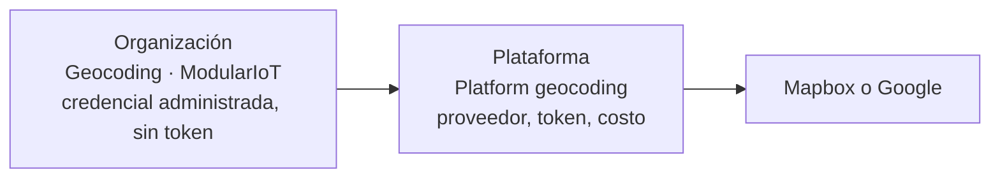

# El proveedor como conexión

**Para:** implementadores y desarrolladores.

El proveedor de geocodificación es una conexión de tipo **Geocoding**, como cualquier otra integración. Hay dos conexiones en juego.

| Conexión | Dónde | Guarda | La crea |
| --- | --- | --- | --- |
| **Platform geocoding** | Ámbito Plataforma | Proveedor, credencial con el token, modo permanente y costo por llamada | Un dueño de la plataforma |
| **Geocoding · ModularIoT** | Cada organización | Una credencial administrada, sin secreto | Un dueño de la plataforma, desde la organización |

Cuando una organización necesita al proveedor:

1. La plataforma comprueba que la organización tenga su conexión administrada.
2. Toma el proveedor, el token y el costo de la conexión de la plataforma.
3. Llama al proveedor. El token nunca sale del servidor y solo se envía al host del proveedor.

## Por qué dos conexiones

| Con dos conexiones | Resultado |
| --- | --- |
| La organización no ve el token | El token lo administra solo la plataforma |
| Cambiar de token o de proveedor | Se hace una vez, en la plataforma, para todas |
| Activar o quitar la geocodificación de una organización | Se agrega o se borra su conexión |
| El costo que paga la plataforma | Queda en cada fila de uso, separado de lo que paga la organización |

## Si una organización trae su propia credencial

Hoy no se puede. Una conexión de geocodificación de la organización que no sea la administrada se rechaza (`geocoding: this organization's geocoding connection is not managed by the platform`), y conectar la administrada la borra. La organización siempre usa el proveedor de la plataforma y su cuota.

## El costo de la credencial

| Campo de la conexión de la plataforma | Efecto |
| --- | --- |
| `costPerRequestUsd` | Se copia en cada consulta al proveedor (`cost_usd`) y suma **Costo proveedor** en Plataforma › Geocodificación › Organizaciones |
| `permanent` (Mapbox) | Con `true`, Mapbox permite guardar el punto y la plataforma lo usa y lo guarda en la caché. Con `false`, ningún resultado se usa |

Cómo se configura en [Configurar el proveedor](/es/products/geocoding/how-to/set-up-provider).
