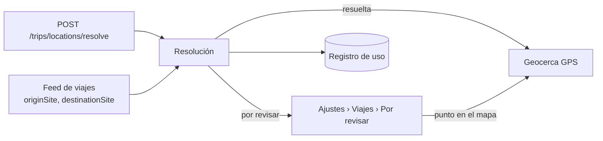

import { Callout, Cards } from 'nextra/components'

# Geocodificación

**Para:** todos. Si está evaluando el producto, lea esta página completa.

La geocodificación de ModularIoT convierte el lugar que declara un viaje en un punto del mapa y en una geocerca GPS. El lugar puede venir como el código de una geocerca, un Plus Code, coordenadas o una dirección. Con la geocerca, la plataforma detecta cuándo el camión llega al origen o al destino.

## Qué resuelve

Un viaje dice de dónde sale y adónde va. Si ese lugar no tiene una geocerca, la plataforma no puede ver la llegada ni la salida. Sin geocodificación, alguien tiene que dibujar cada geocerca a mano.

Con geocodificación:

| Antes | Ahora |
| --- | --- |
| Cada lugar nuevo espera a que alguien dibuje su geocerca | El lugar se ubica solo al llegar el viaje |
| Una dirección mal escrita deja el viaje sin seguimiento y nadie se entera | El lugar queda en **Por revisar** con el motivo |
| Cada consulta a un servicio de mapas cuesta, y nadie sabe cuántas se hacen | Cada resolución automática queda registrada con su fuente y su costo |

## Cómo ubica un lugar

La plataforma prueba fuentes en orden y se queda con la primera que da un punto. Las primeras son gratis. Solo la última cuesta dinero.

| Orden | Fuente | Ejemplo de entrada | Costo |
| --- | --- | --- | --- |
| 1 | Geocerca existente, por código o nombre | `CD-01` | Gratis |
| 2 | Plus Code | `57V4VXHC+H4` o `VXHC+H4` con la comuna | Gratis |
| 3 | Coordenadas | `-33.4569, -70.5976` | Gratis |
| 4 | Direcciones internas (hoy solo Chile) | `Av. Providencia 1208` | Gratis |
| 5 | Caché de resultados anteriores | Una dirección ya consultada | Gratis |
| 6 | Proveedor (Mapbox o Google) | Una dirección nueva | Una consulta, dentro de la cuota |

Después, la plataforma comprueba que el punto cae en la comuna o distrito declarado, con 500 m de tolerancia. Si cae, usa la geocerca que ya contiene el punto o crea una geocerca circular. Si no cae, o si ninguna fuente dio un punto, el lugar queda en **Por revisar**. Una persona lo ubica en un mapa.

Detalle paso a paso en [Cómo se elige la fuente](/es/products/geocoding/tutorials/resolution-order).

## Cuánto cuesta

Solo cuenta una consulta al proveedor. Las geocercas, los Plus Codes, las coordenadas, las direcciones internas y la caché no consumen cuota.

| Concepto | Quién lo define | Dónde |
| --- | --- | --- |
| Costo por consulta que el proveedor cobra a la plataforma | El contrato con el proveedor | Ajustes › Conexiones, en el ámbito Plataforma |
| Precio mensual del plan, consultas incluidas y precio por consulta excedente | El dueño de la plataforma | Ajustes › Plataforma › Geocodificación › Plan |
| Cuota de cada organización y qué pasa al agotarla | El dueño de la plataforma | Ajustes › Plataforma › Geocodificación › Organizaciones |
| Si las cuotas se aplican (**Aplicar las cuotas**) | El dueño de la plataforma | Ajustes › Plataforma › Geocodificación › Plan |
| Qué organizaciones pueden consultar al proveedor | El dueño de la plataforma | Ajustes › Conexiones de cada organización: la conexión **Geocoding · proveedor de la plataforma** |

Un lugar se ubica una sola vez. Los viajes siguientes al mismo lugar usan su geocerca y no consultan de nuevo. Por eso el costo por viaje baja con el tiempo:

| Situación | Consultas al proveedor por viaje |
| --- | --- |
| Origen y destino ya ubicados | 0 |
| Destino nuevo con una dirección que está en las direcciones internas o en la caché | 0 |
| Destino nuevo con una dirección que nadie consultó antes | 1 |
| Origen y destino nuevos, ambos con direcciones nuevas | 2 |

El dueño de cada organización ve su consumo del mes en **Ajustes › Viajes › Uso del mes**. Detalle en [Uso, costo y monitoreo](/es/products/geocoding/concepts/usage-and-cost).

## Qué depende del país

El orden de las fuentes, la caché, la cuota y la API son iguales en todos los países. Cada país necesita además sus límites administrativos (comunas o distritos) y, si existen, sus fuentes de direcciones.

| País | Límites administrativos | Direcciones internas | Proveedor |
| --- | --- | --- | --- |
| Chile | Comunas | Sí (OpenAddresses) | Mapbox |
| Perú | Distritos | No | Mapbox. No certificado: muchas direcciones van a revisión |
| Otros | No | No | Todo lugar queda en revisión |

<Callout type="warning">
**Cuidado:** un lugar sin país, o de un país sin límites administrativos, siempre queda en revisión, aunque traiga coordenadas o el código de una geocerca. La comprobación de la comuna lo exige.
</Callout>

Cómo se agrega un país en [Certificar un país nuevo](/es/products/geocoding/how-to/certify-a-country).

## Riesgos

| Riesgo | Efecto | Cómo se ve |
| --- | --- | --- |
| El proveedor devuelve un punto equivocado dentro de la comuna correcta | La geocerca queda en el lugar equivocado y la llegada no se detecta | El viaje no cambia de etapa al llegar. Se corrige en Ubicaciones |
| El proveedor no encuentra la dirección exacta (solo la calle o la ciudad) | El lugar va a revisión | Ajustes › Viajes › Por revisar |
| La organización agota su cuota | Según su plan: los lugares van a revisión, o cada consulta se cobra como excedente | Uso del mes y una alerta al llegar al porcentaje del plan |
| Dos geocercas del cliente contienen el punto | Se usa la de menor identificador | No se avisa |

## Elija su camino

| Usted es | Quiere | Empiece en |
| --- | --- | --- |
| Responsable del producto o cliente | Saber qué hace, cuánto cuesta y qué riesgos tiene | Esta página y [Uso, costo y monitoreo](/es/products/geocoding/concepts/usage-and-cost) |
| Implementador | Configurar el proveedor y la cuota, preparar la planilla y revisar ubicaciones | [Configurar el proveedor](/es/products/geocoding/how-to/set-up-provider) |
| Desarrollador | Ubicar lugares por API | [Su primera ubicación](/es/products/geocoding/tutorials/first-location) |

<Cards>
  <Cards.Card title="Su primera ubicación" href="/es/products/geocoding/tutorials/first-location" arrow />
  <Cards.Card title="Cómo se elige la fuente" href="/es/products/geocoding/tutorials/resolution-order" arrow />
  <Cards.Card title="Configurar el proveedor" href="/es/products/geocoding/how-to/set-up-provider" arrow />
  <Cards.Card title="API de ubicaciones" href="/es/products/geocoding/reference/locations-api" arrow />
</Cards>

## Dónde entra un lugar

| Entrada | Quién la usa |
| --- | --- |
| `POST /api/v1/orgs/{org}/trips/locations/resolve` | Un sistema que registra lugares por API |
| Los sitios `originSite` y `destinationSite` del feed de viajes | Una integración que envía viajes, por ejemplo desde una planilla |
| La revisión manual | Una persona que marca el punto en el mapa |

## Cómo está organizada esta guía

| Sección | Contenido |
| --- | --- |
| Aprender | Páginas cortas, en orden, con ejemplos de entrada y salida |
| Guías prácticas | Una tarea: configurar el proveedor, asignar una cuota, revisar ubicaciones |
| Conceptos | Qué es genérico y qué depende de cada puesta a punto; el proveedor; el costo |
| Referencia | Cada endpoint, campo, motivo de revisión, tabla y métrica |
