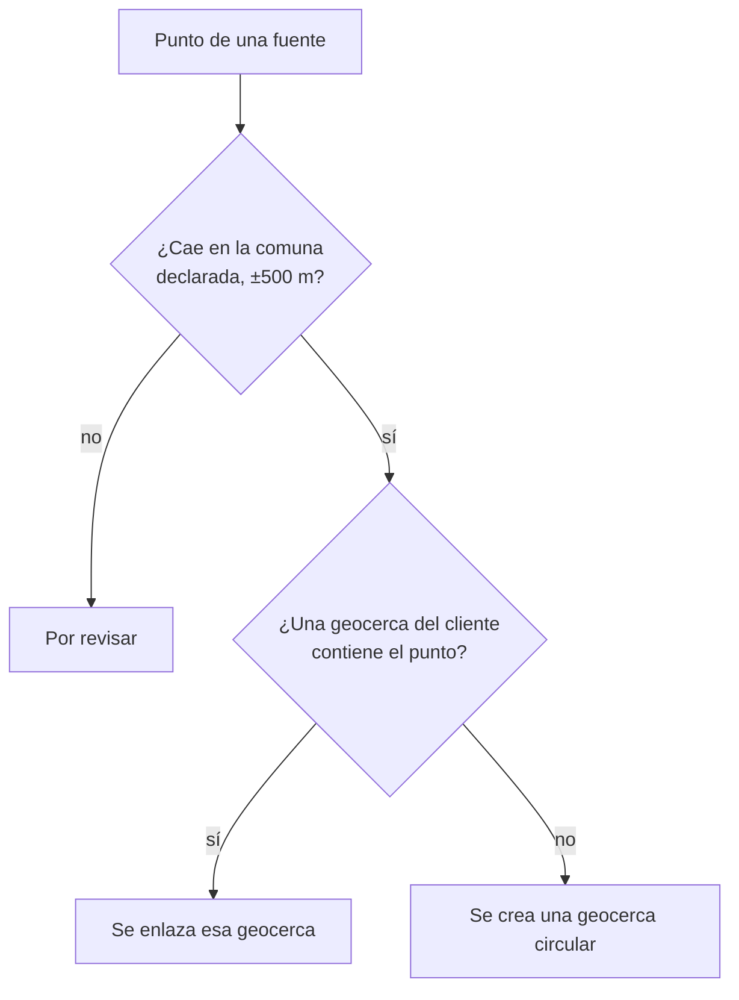

import { Callout } from 'nextra/components'

# Del punto a la geocerca

**Para:** desarrolladores e implementadores.

<Callout type="info">
**Aprenderá:**

- cómo se comprueba que el punto cae en la comuna declarada;
- cuándo el lugar usa una geocerca que ya existe y cuándo se crea una;
- qué radio tiene la geocerca según el tipo de lugar;
- qué deja registrado cada resolución.
</Callout>

Una fuente dio un punto. Antes de que los viajes lo usen pasan dos cosas: la comprobación de la comuna y la elección de la geocerca.



## La comuna declarada

Cada sitio declara su país y su comuna (en Perú, su distrito). La plataforma usa esos datos para comprobar el punto. Sin ellos, el lugar queda en revisión aunque el punto sea correcto.

| Dato | Formato | Ejemplo |
| --- | --- | --- |
| `country` | ISO 3166-1 alfa-2, sin distinguir mayúsculas | `CL`, `pe` |
| `districtCode` | Chile: código de comuna (CUT, 5 cifras). Perú: ubigeo (6 cifras) | `13101`, `150122` |
| `district` | El nombre, sin distinguir mayúsculas, tildes ni espacios repetidos | `Ñuñoa`, `nunoa` |

Si envía los dos, gana `districtCode`. Un código que perdió sus ceros a la izquierda se completa: `2101` es `02101` (Antofagasta). Un nombre que se repite en el país no sirve; envíe el código.

| Situación | Nota de revisión |
| --- | --- |
| Sin país | `country is required to check the district` |
| País sin límites administrativos (cualquiera salvo CL y PE) | `country AR has no district boundaries` |
| Sin comuna | `district is required` |
| Código que no existe | `district code 99999 not found in CL` |
| Nombre que se repite | `district Santa Rosa is ambiguous in PE; send its code` |
| Comuna sin polígono en los datos de límites | `district 150137 has no boundary to check against` |

## La regla de los 500 metros

El punto debe caer dentro de la comuna o a 500 m o menos de su borde. Los polígonos de comunas están simplificados, y un punto real junto al borde puede caer apenas afuera.

Si el punto cae más lejos, el lugar queda en revisión. La nota dice dónde cayó:

```text
the point is in Santiago (13101), not in Providencia (13123)
```

Si el punto cae fuera del país: `the point is outside CL, not in Santiago (13101)`.

El punto se guarda igual en `latitude`, `longitude` y `plusCode`. Quien revisa el lugar lo ve en el mapa.

## La geocerca que ya contiene el punto

Si el punto pasa la comprobación, la plataforma busca entre las geocercas GPS de la organización una que contenga el punto. Si la encuentra, enlaza el lugar con ella y no crea otra.

| Regla | Detalle |
| --- | --- |
| Solo geocercas de la misma organización | Las de otras organizaciones nunca se usan |
| Varias geocercas contienen el punto | Se usa la de menor identificador |
| No se consideran | Las geocercas creadas al ubicar un lugar a mano en la revisión |
| No aplica | A un punto ubicado a mano: ese lugar recibe su propia geocerca |

Si la búsqueda falla (por ejemplo, la base GPS no responde), el lugar queda en revisión con la nota `could not check geofences for the point`.

<Callout type="warning">
**Cuidado:** la búsqueda de la geocerca que contiene el punto llega después de la versión 0.6.0 de la plataforma. En la versión 0.6.0, cada lugar resuelto por Plus Code, coordenadas o dirección recibe una geocerca nueva, aunque otra ya cubra el punto.
</Callout>

## La geocerca circular

Si ninguna geocerca contiene el punto, la plataforma crea un círculo alrededor del punto. El radio depende del tipo de lugar:

| Tipo (`type`) | Radio |
| --- | --- |
| `port` | 1000 m |
| `plant` | 500 m |
| `distribution_center` | 300 m |
| `zone` | 200 m |
| `customer` | 150 m |

Un lugar sin tipo, o que el feed creó solo con un código, es `zone`: 200 m.

La geocerca nueva queda en la base GPS de la organización:

| Atributo | Valor |
| --- | --- |
| Código | El `externalCode` del lugar. Sin código, su `id` |
| Nombre | El `name` del lugar |
| Forma | Un polígono de 32 vértices |
| Propiedades | `created_by: miot-trips`, `location_id`, `location_type`, `resolution_source`, `plus_code` |

Como el código de la geocerca es el `externalCode`, una segunda resolución del mismo lugar la encuentra por código (fuente 1) y no crea otra. Una geocerca del cliente que ya contenía el punto conserva su propio código: en una segunda resolución la fuente 1 no la encuentra, y la búsqueda por contención la vuelve a elegir.

Si la organización no tiene base GPS configurada, no se puede crear la geocerca y el lugar queda en revisión con la nota `the GPS database is not configured`.

## Lo que queda registrado

| Dónde | Qué |
| --- | --- |
| La ubicación | El punto, el Plus Code, la fuente, el estado, la nota y la geocerca |
| Registro de auditoría de Viajes | Una entrada `location.resolved` o `location.needs_review`, con la fuente y la geocerca |
| Registro de uso de geocodificación | Una fila por cada `POST /resolve` o sitio de feed: fuente, resultado, proveedor, si fue caché y el costo. Ubicar a mano y rechazar no escriben fila |
| Viajes abiertos en ese lugar | Se recalculan, para que usen la geocerca nueva |

Los detalles de cada registro están en [Datos y métricas](/es/products/geocoding/reference/data-and-metrics).

## Resumen

- El punto debe caer en la comuna declarada, con 500 m de tolerancia. Si no, el lugar queda en revisión.
- Si una geocerca de la organización contiene el punto, se usa esa.
- Si no, se crea un círculo con el radio del tipo de lugar.
- El código de una geocerca creada es el `externalCode` del lugar.

Siguiente: [Ubicaciones por revisar](/es/products/geocoding/tutorials/needs-review).
